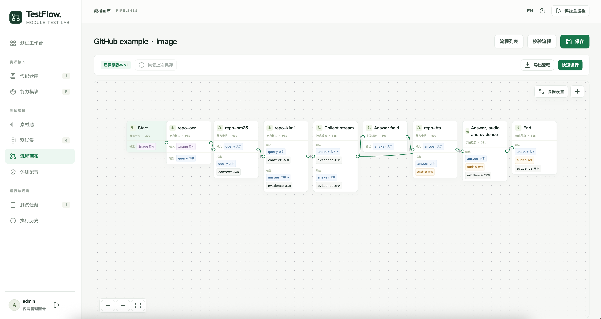
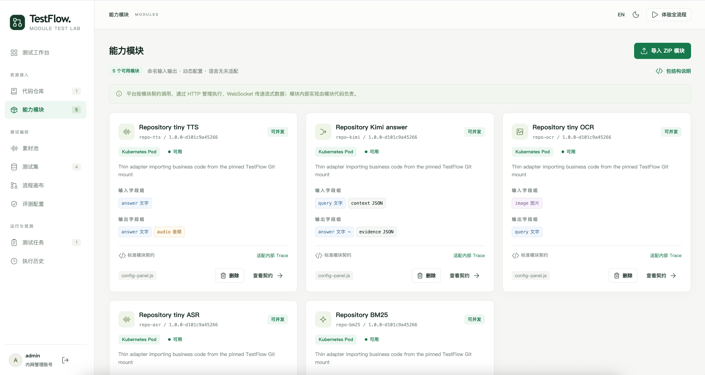
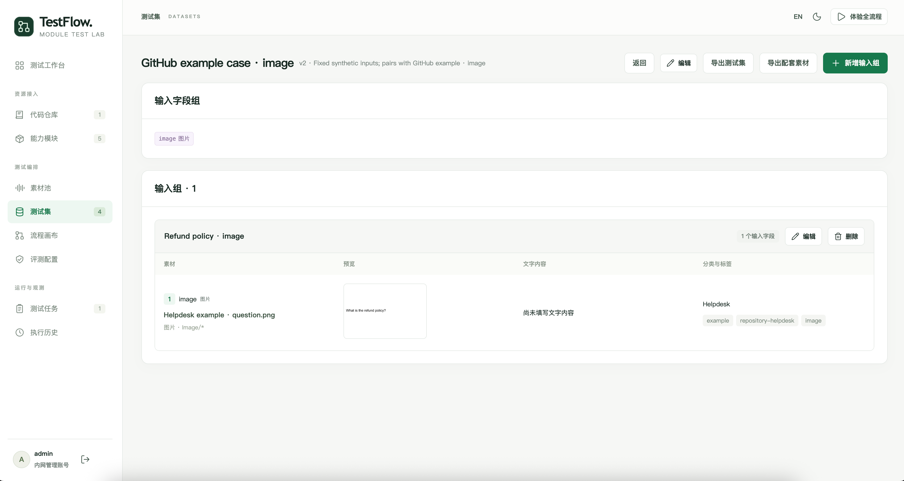
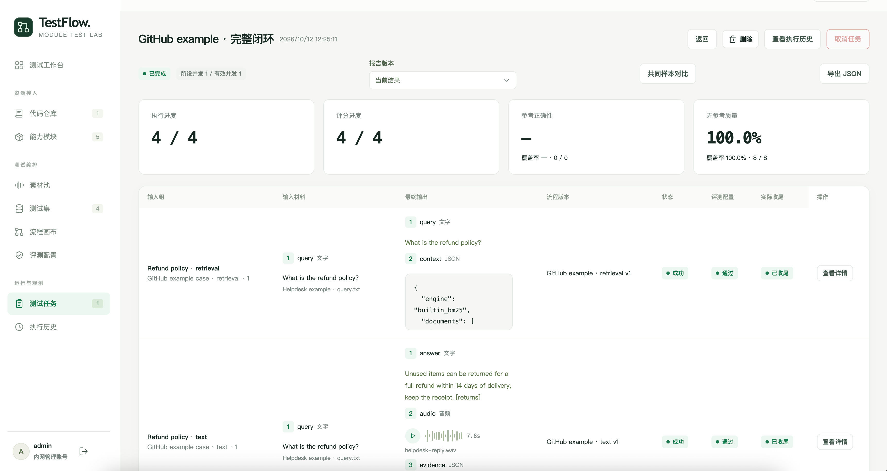

# TestFlow

面向模块能力与多模态流程的可视化测试平台

[快速部署](#快速部署) · [界面预览](#界面预览) · [文档](docs/README.md) · [架构](#架构) · [开发与测试](docs/development.md)

---

## 概述

TestFlow 将代码仓库、能力模块、测试素材、流程编排、批量执行和评测报告连接成完整测试闭环。通过统一模块契约接入不同语言的容器，在可视化画布上组合文字、音频、图片与 JSON 数据，并追溯每次运行的代码、配置、输入输出和评分证据。

适合验证 ASR、OCR、检索、模型问答、TTS 等模块，以及它们组合后的多模态流程。

> 当前版本为 `v0.0.1-beta`，处于快速开发阶段。Docker Hub 提供 Linux AMD64 / ARM64 镜像；开发阶段不保证历史数据和旧协议兼容。

## 核心能力

### 🧩 仓库与能力模块

注册 Git 仓库并固定代码 commit，导入包含输入输出契约、参数 Schema 和动态配置组件的模块 ZIP。模块通过 Kubernetes Pod 运行，支持 Python、Node.js、Go 等语言，也可在模块内部调用第三方服务。

### 🗂️ 多模态素材与测试集

统一管理文字、音频、图片素材、分类和标签，支持媒体预览及素材包导入导出。测试集按有序字段组织输入组，支持 JSON 导入导出及配套素材迁移；素材内容在素材池统一编辑。

### 🔀 可视化流程编排

在 DAG 画布上连接模块与内置节点，校验字段名称、类型、顺序和格式约束。支持字段组装、流式转换、分支、多个结束节点、节点参数、超时设置、快速运行和 workflow 导入导出。

### 📊 批量测试与独立评测

显式配对测试集与流程，配置案例并发，查看执行和评分进度。平台检查完成状态、输出结构等规则，独立评测模型根据原始输入和实际输出判定质量，保留评分依据与无法判定状态。

### 🔎 执行历史与结果追溯

查看节点输入输出、耗时、Trace、代码 commit、模块镜像与配置快照。支持取消、重跑、复评和历史报告；新执行与新评分追加记录，旧报告保持固定结果。

### 🌗 统一桌面工作区

提供中文、英文及浅色、深色主题，使用统一组件与设计 Token。当前正式体验与验收范围为 Web 桌面端。

## 界面预览

### 流程画布

组合 OCR、检索、模型问答、流式转换和 TTS，查看每个节点的输入输出字段与连接关系。



### 能力模块

集中查看模块契约、输入输出、版本、动态配置组件和 Kubernetes 运行可用性。



### 测试集

以输入组组织测试素材，预览图片、音频与文字，导出测试集及其配套素材。



### 测试任务

查看执行和评分进度，检查每组输入的实际输出、流程版本、评测结果与收尾状态。



截图来自已配置的示例工作区；新安装从空工作区开始。示例导入步骤见 [GitHub 仓库与多模态测试闭环](examples/repository-helpdesk/README.md)。

## 架构

TestFlow 采用按业务域组织的单体后端。前端、后端、数据库和动态模块 Pod 部署在同一 Kubernetes namespace，后端管理持久队列、DAG 调度和模块生命周期。

| 组件     | 技术与职责                                                                                  |
| -------- | ------------------------------------------------------------------------------------------- |
| Web 门户 | React 19、TypeScript、Vite、HeroUI、Tailwind CSS、React Flow；Nginx 同源代理 HTTP/WebSocket |
| 平台后端 | Python 3.13、FastAPI、SQLAlchemy async；单副本、单 Uvicorn 进程                             |
| 数据库   | PostgreSQL 18、Alembic；资源修订、执行计划、历史和评测记录                                  |
| 模块 Pod | 语言无关容器；HTTP 管理执行，WebSocket 传递流式数据，可只读挂载固定 commit 的仓库代码       |
| 持久存储 | 平台 PVC 保存模块包、仓库代码、素材和产物；数据库使用独立 PVC                               |

详细边界见 [工程结构与部署](docs/voice-test-platform/15-工程结构与部署.md)、[模块契约](contracts/module/README.md) 和 [执行与 Trace 设计](docs/voice-test-platform/09-执行与Trace设计.md)。

## 快速部署

### 前置条件

- `kubectl` 已连接目标 Kubernetes 集群。
- 集群配置默认 StorageClass，支持 RWO 持久卷。
- 集群可拉取 Docker Hub 的平台镜像及 `postgres:18`。

### 安装

下载本仓库中的 `deploy/k8s/beta` 部署目录，执行：

```sh
kubectl apply -f deploy/k8s/beta
```

清单会创建 `testflow` namespace，自动生成私有配置、启动 PostgreSQL、执行数据库迁移，再启动前后端。首次安装需要等待镜像拉取与持久卷就绪。

后续版本继续使用 `testflow` namespace，Beta 或正式版本由部署清单中的镜像标签区分。

数据库密码和凭据加密密钥在集群内随机生成，重复 apply 保留已有配置。镜像支持 Linux AMD64 / ARM64，由集群按节点架构拉取。

### 访问与登录

```sh
kubectl -n testflow port-forward svc/testflow-web 18765:8080 --pod-running-timeout=5m
```

打开 <http://127.0.0.1:18765>，初始登录为 **`admin / 123456`**。

需要修改访问地址时，先编辑部署目录中的 `01-config.yaml`，将 `TESTFLOW_PUBLIC_URL` 设为实际浏览器地址。域名入口、TLS、存储和备份见 [部署手册](deploy/k8s/README.md)。

### 已发布镜像

| 镜像                                                                                | 用途                       | 架构                |
| ----------------------------------------------------------------------------------- | -------------------------- | ------------------- |
| [`kakj/testflow-server:v0.0.1-beta`](https://hub.docker.com/r/kakj/testflow-server) | 后端 API、调度与数据库迁移 | Linux AMD64 / ARM64 |
| [`kakj/testflow-web:v0.0.1-beta`](https://hub.docker.com/r/kakj/testflow-web)       | Web 门户与 Nginx 代理      | Linux AMD64 / ARM64 |

`postgres:18` 为独立数据库依赖。模块镜像由模块包声明，使用前应确认集群可以拉取；平台镜像版本与模块包版本独立管理。配置与排障见 [Kubernetes 部署手册](deploy/k8s/README.md)。

## 开始使用

1. **接入能力**：按需注册并同步代码仓库，导入模块 ZIP，准备模块镜像并验证运行可用性。
2. **准备输入**：向素材池导入文字、音频或图片，创建测试集并组织输入组。
3. **编排流程**：连接模块与内置节点，设置输入输出、参数和超时，校验保存后快速运行。
4. **配置评测**：选择规则与独立评测模型；模型 API Key 在模型表单中填写并加密保存。
5. **提交任务**：配对测试集与流程，选择评测配置和案例并发，开始执行。
6. **查看结果**：检查报告、媒体产物和 Trace，按需重跑、复评或导出流程与测试数据。

[仓库代码闭环示例](examples/repository-helpdesk/README.md) 提供五个模块、四个 workflow、素材包和测试集，可体验离线检索以及文字、语音、图片问答。使用示例前，请确认模块运行配置中的镜像可从目标集群拉取。

## 文档

- [文档总索引](docs/README.md)
- [开发环境与测试](docs/development.md)
- [产品设计与当前决策](docs/voice-test-platform/README.md)
- [Kubernetes 部署、存储与备份恢复](deploy/k8s/README.md)
- [模块开发契约](contracts/module/README.md)
- [workflow 导入导出](contracts/workflow/README.md)
- [素材与测试集交换](contracts/data/README.md)
- [GitHub 仓库与完整示例](examples/repository-helpdesk/README.md)
- [E2E 与浏览器验收](tests/README.md)
- [最新输入组与工作区设计](docs/voice-test-platform/23-输入组与简化工作区.md)

高级缓冲与慢消费者策略，以及 ai、robot-voice-agent 专用适配属于后续范围；实际麦克风采集保持暂缓验收。当前能力与验收限制以设计文档和实际实施记录为准。

## 贡献

欢迎通过 [Issues](https://github.com/Minecodex/TestFlow/issues) 反馈问题与建议，或提交 Pull Request。开发前阅读 [AGENTS.md](AGENTS.md) 和相关设计文档，遵循统一组件、双语主题及架构边界，并完成相应验证。
