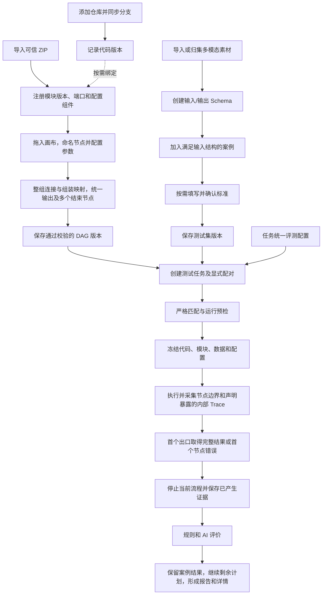
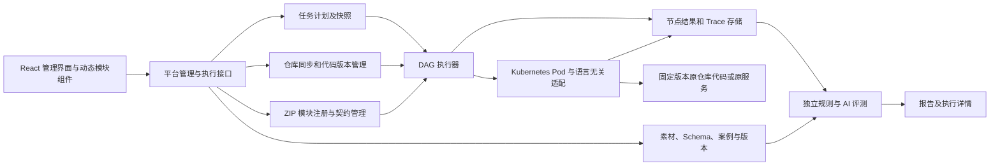

# 模块能力测试平台整体设计

## 目标与范围

平台面向内部人员，通过语言无关适配模块封装外部接口或按需引入仓库代码，构建可执行流程，测试音频、文字、图片等输入经过模块组合后的输出质量、结构和耗时。

当前范围是模块能力及其组合测试。一个案例触发一次流程执行；平台不维护多轮会话步骤或产品对话历史。模块内部可以使用历史和缓存，并通过自己的配置界面决定行为。平台提供执行上下文和观察能力。

代码来源不限于 ai 或 robot-voice-agent。两个仓库可以按需要注册，既有服务接口也可以由模块调用。原仓库源代码保持不变，平台不要求其内部改造成流程引擎。原先“专属内部固定流程 + 线性模板”不再作为架构基础；测试内部代码能力同样通过导入模块进入 DAG。

平台只对接统一模块契约及Kubernetes Pod 启动，使用 HTTP 管理/WebSocket 流式契约。模块内部的接口调用、代码引用及私有协议由模块代码决定，不作为平台能力来源分类。平台按模块声明准备运行依赖并管理生命周期；内部执行状态仅按模块上报证据展示，不以本地退出推断内部所有活动已停。

## 页面与职责

| 页面 | 内容与操作 |
| --- | --- |
| 代码仓库 | 地址、访问凭据、分支、同步状态、代码版本 |
| 模块管理 | ZIP 导入、版本、后端运行要求、Pod 启动、输入输出与前端配置入口 |
| 素材池 | 音频、文字、图片的导入、归集、预览、标签和修订 |
| 测试集 | 命名且有序的输入结构、输出结构、案例数据与可选标准 |
| 流程集 | DAG 画布、开始/结束节点、模块连线、配置、版本与快速执行 |
| 评测配置 | 规则、独立评测模型、提示词、维度和合格线 |
| 测试任务 | 显式配对、计划、执行、进度、对比与报告 |
| 执行历史 | 跨任务过滤、全部尝试及共享详情 |

“测试历史”是测试任务列表及详情，不复制另一套执行数据。任务列表和全局执行历史打开同一执行详情。

## 业务流程

输入结构完整是案例进入测试集的条件。标准答案不是输入完整性的条件，标准缺失时仍可执行适用的无参考答案质量评价。标准不会注入被测模块。

## 系统职责

平台负责代码与模块登记、契约校验、调度、停止、记录和评分；模块负责参数界面、能力调用、注入/拦截、内部状态及主动暴露的内部 Trace。

平台与模块通过 HTTP 管理执行、WebSocket 传递流式输入输出；模块在自己的Kubernetes Pod 环境中处理依赖、代码加载及注入。具体模块依赖/构建准备、就绪检查、端口发现和复用范围在实施时确定，管理服务不直接加载所有模块语言运行时。

## 关键执行约定

- 一个命名开始节点，可新建多个结束节点；图不允许循环。
- 同一份完整输出组可分发到多个下游，复用同一次上游产出；各普通输入接唯一前置，逐字段匹配名称、顺序、类型、格式及流式模式，不直接混接或拆字段。
- 内置组装节点接多个来源，等待所需数据，显式选字段、排序并形成目标组；未选字段不传下游，原产出仍保存。
- 每个结束节点唯一前置，全部共用流程输出规范；任一出口先取得完整组即成功并停止其他分支。所需非流字段有完整值，所需流式字段全部正常结束，文字和音频均必需时两者齐备。
- 各节点在流程界面配置平台超时相关设置，超时作为错误。任一节点错误立即停止当前流程；已确定的成功、失败或取消终态保持不变，后续事件不改判。
- 单条案例失败保留错误并继续其他案例；用户取消任务才停止全部计划。
- 流式与非流式两个方向均不直接跨模式连接，使用内置显式转换；开始可从完整素材生成声明输入流。
- batch_id、execution_id、node_id 同时传给模块，缓存由模块控制，重跑新增实际执行身份。
- Q52 明确：所需非流式字段齐备、所需流可读取时组装并启动下游，持续透传，不等待所有流收完；最终结果仍按 Q51 等所需流正常结束。
- Q54 确认任务同时执行案例数默认 1、可调整；所选流程模块要求顺序时限制任务串行。案例并发和同一案例的图内分支并行分开，平台不管理模块历史。
- Q55 将超时相关设置放在流程界面，具体选项与默认值留在工程契约；Q56 暂缓缓冲处理；Q57 确认收尾单独限时并记录实际状态。具体消息、媒体和运行环境在实施时确定。

“立即停止”先停止调度和数据派发，再取消正在执行的模块。收尾有单独期限，到期记录收尾超时并终止平台可控执行；实际远端请求是否已停止按证据记录，不将取消请求或本地终止当成远端取消已完成。逻辑终态与实际收尾分别展示，已有产物和 Trace 保留。

## 评测与报告

精确输出由规则判断，开放表达由独立 AI 根据维度和证据评分。标准可选，但任务目的和评分规则必须明确。

分别展示结构/执行检查、参考答案正确性、无参考答案质量。没有参考转写不计算 CER；无依据的维度显示无法判定或未评测。全部必需维度有效且通过才整体通过，继续不设统一加权总分。

一个任务可配置多条测试集与流程配对，不产生未选择的交叉组合。任务统一评测配置，各配对检查维度适用性。通过率和覆盖率按相同口径分别计算。

## 保留的管理边界

唯一 admin 登录、不建设个人账号或人员记录；无人工评分或改判，人工确认标准仍保留。全部资源、版本、执行、评测和报告保留，删除只隐藏并阻止新选，历史媒体继续可读。

现有“不执行真实动作或被测业务写入、不建模拟业务验收端”的边界仍有效。平台自身保存记录不属于被测业务写入。模块必须真实声明执行范围，不能通过返回假成功继续原业务链路。

## 工程落地与部署

2026-10-11 已按完整实施计划实现前后端。平台后端采用 Python 3.13 + FastAPI，业务域、持久调度和执行器组织在同一单体服务内，不拆独立 Worker。正式前端位于 web 工作区，九页及执行详情六页签接入真实 API，支持双语和深浅主题。PostgreSQL 18、SQLAlchemy async、Alembic 保存不可变版本、计划、运行、事件、评测和报告。

平台采用 Kubernetes 部署前端、Python/FastAPI 单体、PostgreSQL 18 和容器模块 Pod。一个后端 Pod、一个 Uvicorn 进程，业务操作和任务持久化后由服务内调度器领取。代码、素材、包和产物使用 PVC；RWO 时模块与后端安排在同一节点。

Git 同步、ZIP/动态组件、鉴权、业务版本、DAG、真实三语言 Pod、规则及 Kimi 评测、重跑和历史均已运行验证。两个被引用项目的专用适配仍独立于本次交付，未修改它们的源码。目录和启动见 [工程结构与部署](15-工程结构与部署.md)，实际证据与用户暂缓的麦克风验收见 [实施记录](16-完整实施记录.md)。
