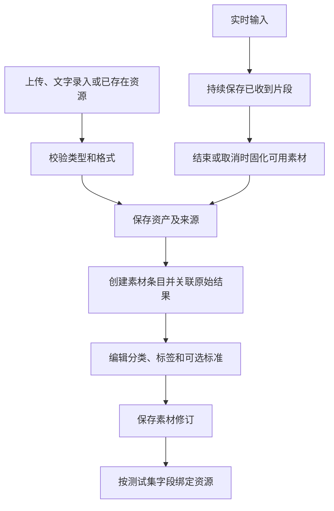

# 素材池与多模态输入资源设计

本文件保留原“语音池设计”的文件名，内容扩展为当前多模态测试需要的素材管理。素材池用于保存输入证据和资源，不编排会话。音频、文字、图片可组合成案例的多个命名字段。

## 素材与资源

| 层次 | 职责 |
| --- | --- |
| 资源资产 | 不可变音频/图片文件或文字内容、摘要、格式和来源 |
| 素材条目 | 名称、类型、分类、标签、来源、原始结果和当前修订 |
| 素材修订 | 固定文本、标注、标签或说明，供案例版本引用 |
| 案例输入 | 依照测试集 Schema 把资源绑定到 audio、instruction 等字段 |
| 可选参考 | 已确认转写或人工标准，仅供对应评测使用 |

原始识别文本与人工校正转写分别保留。修改“识别内容”形成标准修订，不覆盖原始证据。输入文字与参考文字也分别保存，避免把标准答案误用为模块输入。

## 素材格式

| 类型 | 保存信息 | 预览 |
| --- | --- | --- |
| 音频 | 内容摘要、媒体类型、编码、采样率、声道、时长、采集阶段、完整性 | 播放、查看格式 |
| 文字 | 原文、编码、来源、修订 | 阅读与差异 |
| 图片 | 内容摘要、媒体类型、尺寸和来源 | 预览 |
| 模块产物 | 产物类型、执行 ID、节点/Span 引用、原始资源关联 | 按类型展示 |

大资源在执行结果与 Trace 中用资源引用表示，不将全部字节嵌入事件。格式转换产生独立产物并保留来源；处理后音频不能标成原始麦克风录音。

## 输入方式与归集

支持素材上传、文字录入、已有保存资源引用，以及平台实时录音归集。原先正常和异常可用音频均保留、允许待标注的规则继续有效。

真实用户使用素材能否自动归集取决于原入口是否已有音频或代理采集能力。平台不修改被引用仓库，也不能从识别文本还原未保存的音频。模块或现有接入提供的资源按实际来源保存；缺失资源明确显示。

实时录音自动入池，关联原执行；取消和断连时保留已保存的可用片段并记录完整性。回放已有素材不重复入池，重连与重复通知依据来源标识去重。自动入池不自动加入测试集或确认标准。

## 标注、分类与标签

分类组织业务场景，标签用于筛选，可以多选；模块类型不被原闲聊、控制、备忘录、定时任务、会议纪要等分类限制。原分类可继续作为标签体系中的业务组织信息。

正确标准直接确认，需要修正的编辑后确认。素材无需立即标注，标准是否必需由具体评价维度决定。ASR CER 需要参考转写；无参考答案质量评价采用明确维度，不伪造参考文本。

案例的预期意图、参数或最终结果在案例参考中填写，不能从素材分类或标签自动生成。

## 与测试集的关系

一个案例可引用多个资源，例如一个音频、一段任务说明、一段上下文和一张图片。同一资源可被多个案例复用。只有满足测试集全部必填字段和约束，案例才可加入该版本。

文字上下文作为普通命名输入交给模块；平台不把它解释为有序历史步骤，也不为其维护多轮状态。

素材池保留完整资产。流式是开始节点或模块端口的供给方式，不要求素材池保存一个活跃连接。

## 列表与详情

按类型、来源、分类、标签、时间、文字和标准状态筛选。详情展示原始内容、格式、来源执行、修订、引用案例和相关输出。音频原始/处理后/输出阶段分开，图片与文字有相应预览。

没有音频不能显示可播放，采样率或采集阶段未知时标记未知。AEC 等能力需要的多路参考由模块输入组和案例字段声明，完整输入组交付；不同上游的参考先经过内置组装，不能用普通单路音频替代。

## 版本与删除

资源内容和已引用修订固定保留。编辑产生新修订，新任务可选择新内容，旧案例和旧执行保持原引用。

删除只是隐藏素材并阻止新选，不清理条目、版本、资源或历史；已有历史音频仍可播放。外部临时 URL 不作为永久历史的唯一依据，已取得产物需固化到平台资源管理范围。

## 验收要点

音频、文字、图片能绑定到命名输入；原始证据与参考分开；未标注素材可执行适用评价；实时录音自动入池；重复通知不重复创建；隐藏资源后旧执行仍可读取和播放。
