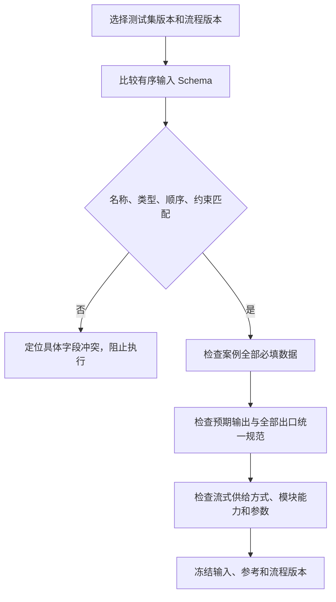
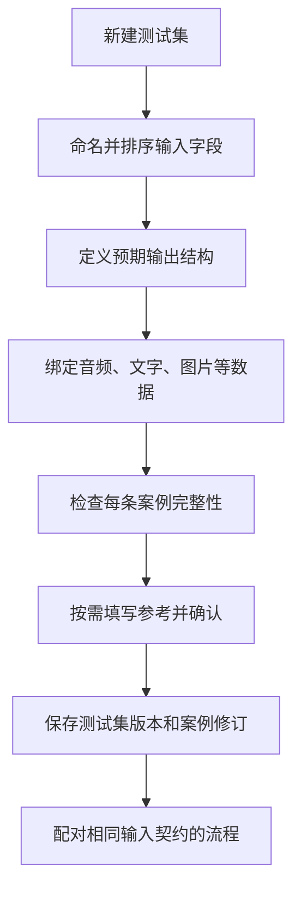

# 测试集、输入结构与可选参考设计

## 当前范围

测试集由固定输入结构、预期输出结构和案例成员组成。每条案例是一次流程调用的数据，不再提供单句/多轮/会议三类执行器或有序对话步骤。长会议录音可作为一个音频字段；历史文字可作为普通输入，但具体解释和状态管理由模块负责。

## 输入结构

创建测试集时先定义有序字段。字段具有唯一名称、数据类型、必填要求和格式约束。

| 顺序 | 名称 | 类型 | 示例用途 |
| --- | --- | --- | --- |
| 1 | audio | Audio | 待识别音频 |
| 2 | instruction | Text | 本次任务说明 |
| 3 | context | Text | 允许提供的上下文 |
| 4 | image | Image | 图像材料 |

仅比较 Audio、Text、Text、Image 不够，两个 Text 必须用名称区别。字段顺序存储在 Schema 数组中，不依赖 JSON 对象键的序列化顺序。

创建后，加入该测试集的案例必须提供全部要求的数据并符合格式。只定义一个 Audio 字段的集合不能加入缺音频案例；定义音频、文字、图片的集合必须全部齐备。结构编辑产生新版本，不静默改变历史案例含义。

## 输出结构与标准答案

预期输出结构与具体参考内容分开保存：

- 输出结构说明最终需有哪些字段及类型，例如 reply: Text、speech: Audio。
- 标准答案可选，可以按输出或维度填写文本、结构化参数、关键事实或评分要求。
- 系统预填的参考需确认才能作为正式参考；无参考不阻止保存满足输入结构的案例。
- 输入文字不自动成为标准，标准也不注入开始节点。

有标准时执行适用的规则及 AI 参考评价；无标准时执行结构检查和有依据的无参考答案质量评价。必须有参考才能计算的指标保持未评测。

## 与流程的严格匹配

测试集输入与开始节点逐字段检查名称、类型、顺序及格式约束，形成完整输入组；预期输出结构与流程统一输出规范校验，所有结束节点引用该规范。不能按相似字段名自动映射、调换两个 Text 或忽略缺失字段。

图内普通节点也按完整组绑定，不能直接从不同节点拼字段。需要选取或组装字段时通过内置组装节点显式配置，不改变测试集与开始节点的严格匹配。



流式输入由开始节点从完整素材生成，不要求测试集保存一个正在运行的流。结束输出中的所需流必须正常结束才算完整，首片段或提前截断不算完整结果；这不要求把流式输入改为批处理。图内两个方向均不直接跨流式模式连线，使用显式转换节点。源资产格式必须满足生成该输入流的要求；切块、回放节奏和具体协议需在流程配置中声明，默认策略尚待细化。

## 案例结构示例

以下字段是目标契约示意，不是既有 API：

```json
{
  "case_revision_id": "case-r1",
  "input_schema_version_id": "input-schema-r1",
  "inputs": {
    "audio": {"asset_id": "audio-1"},
    "instruction": {"value": "结合音频和图片回答问题"},
    "context": {"value": "这是本次测试允许提供的背景"},
    "image": {"asset_id": "image-1"}
  },
  "expected_output_schema_version_id": "output-schema-r1",
  "references": {
    "reply": {"status": "confirmed", "key_facts": ["需要包含的事实"]}
  }
}
```

references 可以为空。输入完整性不由 references 是否存在决定。平台没有 steps、send_after 或上一回复推进条件。执行 ID 和内部缓存行为属于模块执行上下文及配置，不属于平台多轮案例。

## 创建流程



不符合输入结构的条目可以作为未完成草稿，但不能加入可执行的成员清单。无标准答案不是结构缺失。

## 成员、去重与版本

集合内部相同案例修订只保留一次；不同输入、上下文或标准修订属于不同案例。不同配对即使使用同一案例也分别执行，不共享一次运行结果。

新增、移除、重新绑定素材、改变 Schema 或参考时生成新版本。历史任务固定原成员和原参考。对原执行采用新参考复评时，新参考必须对应同一实际输入；输入改变需要重跑。

删除集合、案例或素材只隐藏并阻止新选，历史成员、引用及媒体保留。

## 列表与验收

列表显示输入/输出结构、版本、成员数、参考覆盖和最近任务。详情逐字段编辑，不显示多轮步骤编辑器。

验收包括：重复 Text 有独立名称；顺序不符被拒绝；缺任一必填数据不能成为有效成员；标准为空可执行质量评价；完整素材可供给流式开始端口；旧版本及媒体不随编辑和隐藏变化。
