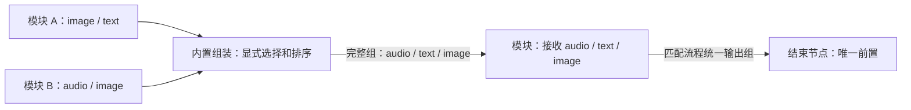
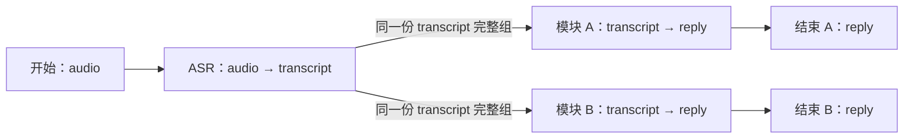

# DAG 流程集、整组连接与组装节点设计

## 画布配置入口（2026-10-12）

画布默认占满编辑区，不常驻显示模块库或流程配置侧栏。画布右上角 `+` 展开模块与内置节点库，支持搜索、添加与关闭；关闭不改变流程草稿。拖动节点只更新位置，点击节点才打开右侧配置抽屉。

开始节点在抽屉中编辑流程输入字段组；任一结束节点在抽屉中编辑统一输出字段组，修改同步到全部结束节点。模块节点抽屉只编辑名称、描述和业务参数；组装编辑映射，转换节点编辑方向。Pod 和仓库挂载在能力模块中保存，节点继承固定修订。节点超时和能力版本在流程设置弹框调整。连线悬停显示删除按钮，点击线段只选择连线；点击删除按钮后确认。节点删除按钮位于画布节点上，固定开始节点不能删除。

画布右上角“流程设置”通过弹窗编辑名称、说明、准备超时和独立收尾超时。取消不应用修改；保存应用到流程草稿，再由“保存”生成新版本。取消弹窗、关闭节点抽屉及缩放不会触发执行。

## 流程模型

正式平台支持 [`testflow.workflow.v1` 导入与导出](../../contracts/workflow/README.md)。图与依赖可传播到另一套安装；模块固定 ZIP 摘要和版本，仓库固定 URL/commit，凭据在目标环境显式重新选择。先预览依赖和图错误，再通过幂等请求创建新流程；导入不自动执行。开源仓库示例见 [repository-helpdesk](../../examples/repository-helpdesk/README.md)。

流程使用同一 DAG 执行器，由开始节点、导入 ZIP 模块、内置组装/转换节点和一个或多个结束节点组成，不允许循环。开始节点命名并定义有序输入；所有结束节点引用同一份流程输出规范，每个结束节点只连接唯一前置节点。

Q43–Q45 将普通连线改为完整数据组绑定：一条连线传递上游声明的一整组输出，与下游的一整组输入匹配，不在普通节点之间逐字段混接。需要多来源、选字段或改变字段排列时，使用内置组装节点。

Q50 确认同一份完整输出组可分发到多个下游，各下游字段一一匹配；分叉复用同一次上游产出，不重新执行上游。普通输入唯一前置，输出允许多条完整组链路；拆分、选择或合并字段使用内置节点。

不再采用线性模板或专属内部固定流程执行器。测试仓库内部整体能力时，由 ZIP 模块封装其入口；平台只按契约调度和观察。

模块后端语言不改变 DAG 连接规则。节点固定模块版本、Pod 运行设置和模块业务参数，按包声明保存所需代码依赖版本。全部模块容器化，镜像使用 ENTRYPOINT/CMD；平台与模块使用 HTTP 管理/WebSocket 流式，模块内部调用何种服务或代码由模块实现。

## 普通节点的完整数据组

输入和输出分别由有序字段数组定义，每个字段有唯一名称、类型、格式和流式属性。完整组绑定要求字段数、名称、顺序、类型、流式模式及格式约束匹配；实际值也要符合 Schema。

| 上游输出 | 下游输入 | 直接连接 |
| --- | --- | --- |
| Image | Image | 契约匹配时允许 |
| Text | Text | 契约匹配时允许 |
| Text + Image | Text + Image | 整组匹配时允许 |
| A.Text 和 B.Image | Text + Image | 不允许直接混接，经过组装节点 |
| Text + Image | Text | 不允许直接抽取，经过组装节点 |
| Audio + Image | Audio + Text + Image | 不允许缺字段，需要明确来源及组装 |

表中模态是示意；实际两个 Text 等仍按名称区分。普通节点的输入来自同一个前置节点的一组输出，不能从不同来源分别补齐字段。完整组是绑定单位，不表示流式内容必须一开始已全部生成。Q51 已确认结束节点所需流全部正常结束才算完整；Q52 已明确：组装在所需非流式字段齐备、所需流可读取时启动下游并持续透传；就绪与最终结果完整分别判断。

## 内置节点

| 节点 | 已确认职责 | 仍需细化 |
| --- | --- | --- |
| 开始 | 定义命名有序输入；从完整素材或实时来源供给数据/输入流 | 分块、回放节奏和完成协议 |
| 组装 | 多来源显式映射；所需静态字段齐备、所需流可读取时启动下游并持续透传 | 流同步及消息协议；缓冲处理暂缓 |
| 流式转换 | 完整数据与流之间显式转换，两个方向不直接跨模式连线 | 分块、编码、完成及取消协议 |
| 结束 | 多个实例共用规范、各唯一前置；任一先取得完整组即成功，所需流正常结束 | 收尾期限值、可控终止及协议实现 |

组装节点是允许多前置来源的例外，每个来源接入一整组输出；字段选择在该节点的映射配置中完成。输出组仍按同一契约传给下游。平台不根据同名字段自动挑选来源。

内置节点同样固定版本、参数和运行契约，记录输入、输出、等待和耗时。组装只是选择、命名、排序和包装数据，不自动完成 ASR、图片理解、混音或文字拼接等内容处理。

## 组装配置与字段取舍

组装节点配置来源组、目标输出 Schema，以及每个目标字段对应的来源节点和字段。所有目标必填字段均需有明确来源；多个来源有同名或同类型字段时仍显式选择。

用户示例中，A 输出 image 与 text，B 输出 audio 与 image，目标为 audio、text、image。可配置：

| 目标顺序/字段 | 类型 | 选取来源 |
| --- | --- | --- |
| 1 audio | Audio | B.audio |
| 2 text | Text | A.text |
| 3 image | Image | B.image |

这是一种合法映射示例，用户也可以选 A.image。未选中的 A.image 不传给下游。原节点已经实际产出的完整输出继续保留于 Trace/历史，沿用 Q24 全部历史保留；“丢弃”表示不进入目标组，不物理清理历史资源。

只依赖被选字段所在的来源组，不把无关未连接来源当作必须等待项。所需来源失败仍触发当前流程立即停止；没有生成的数据不能凭空补齐。Q52 已确定就绪后可以持续传流；Q53 确定节点超时可由平台设置并按错误处理。超时相关设置在流程界面配置，具体计时选项和流同步协议在实施时细化；缓冲处理按 Q56 暂缓。

## 组装局部示意

以下展示多来源组装的局部规则，完整组分叉已由 Q50 确认：

连线标签是完整组，内部配置选择 B.audio、A.text、B.image。不能把三条字段线直接分别连接到普通模块 M。

## 完整组分叉与多个出口示例

ASR 只执行一次，两条链路消费其同一份产出；各模块输入均匹配 transcript 的名称、类型、顺序、格式和模式。两个结束节点共用 reply 输出规范，先取得完整结果的一路成为整体结果，并取消其他活动分支。

要分别评价两种模块，应建立两个流程并配置两条测试配对。这个多出口流程用于先完成结果的竞争，未采用分支的实际产出保留在 Trace，不默认形成两份独立整体评分。

## 画布交互与校验

模块库默认隐藏，画布右上角 + 打开可用 ZIP 模块、组装和流式转换等节点；右侧抽屉编辑节点名称、描述和业务参数。普通节点展示整组输入和整组输出连接点，抽屉不重复显示只读契约。组装节点展示多个来源组入口，右侧编辑字段映射。节点和连线的删除控件位于画布，鼠标悬停或键盘焦点时显示。

开始节点编辑流程输入；流程层编辑一份统一输出规范，所有结束节点引用它，不能各自配置不同输出结构。可新增、命名结束节点，每个只允许一条来自唯一前置的完整组连线。

草稿可不完整，可执行版本必须校验：

- 图无环，开始可达、结束可达，必需连接齐备。
- 普通节点及每个结束节点只有一个前置，整组契约匹配。
- 组装节点来源、目标 Schema、字段映射及必填供给合法。
- 所有结束节点引用同一输出规范，来源输出组与其匹配。
- 不隐式转换类型、格式或流式模式；跨模式使用明确转换节点。
- 模块/内置节点版本、代码绑定和参数合法，运行输出符合声明。

同一输出组允许多条下游连线，每条均整组校验，连第二个下游不重跑来源节点。若两条链路需要不同字段组，各经内置拆分/选择生成目标组，仍引用同一份综合产出。

## 多结束节点与终态

多个结束节点代表多个合法出口，每个接收一个完整候选输出组。要求 Text + Audio 时，单个结束节点的这两个字段必须来自其唯一前置输出组，缺任一项不能满足条件。

Q49 确认：任一结束节点先取得符合统一规范的完整结果组，就使当前流程成功；记录该出口和整组结果，停止其他活动分支。无需等待其他结束节点，后到结果不覆盖已选组，不能跨出口拼字段。若节点错误先到则失败。

Q51 确认：所需非流式字段按完整值，所需流式字段全部收到正常结束标记才算完整。首片段用于实时展示和首片段耗时，提前截断不满足结束条件。因另一个出口已成功而取消的流保留取消/截断状态，不推翻整体成功。

Q37/Q41 的流式能力继续保留；结束等待完整结果与中间模块逐片消费是不同阶段。Q52 已确认组装就绪后启动下游并持续传流，仍保留各字段的流式属性；需要完整值时经过显式转换。流同步协议在实施时细化；慢消费者及缓冲策略按 Q56 暂缓。

任一节点错误立即停止当前流程，不等待另一分支成功；成功后的取消异常不改判，失败后的晚到输出不改判。停止调度和模块实际收尾分开，未运行节点显示原因，不标成成功。

Q47 明确：单条案例失败保留错误，批量任务继续剩余案例；用户取消整个任务才停止全部计划。

## 平台侧节点超时

Q53 确认每个节点可以在平台侧设置超时时间，超时作为节点错误处理，沿用首错误立即停止当前案例流程、批次继续其他案例的规则。已成功收敛后的收尾异常不改判。

Q55 明确超时相关设置在流程界面配置，属于平台节点执行设置，和 ZIP 自定义业务参数分别保存，随流程/执行快照固定。画布节点配置与历史详情显示实际生效配置、计时证据和错误原因。内置节点同样使用平台执行配置。

本答复没有限定起算点、计时范围或默认模式，具体配置选项在工程契约中细化，不将原题固定计时建议当成已接受。Q56 明确暂缓流式供给过快、缓冲满及慢消费者处理，不纳入当前待回答问题或本轮验收。

## 停止后的收尾

Q57 确认停止请求后有独立收尾期限。到期仍未退出则记录收尾超时，并终止平台可控制的执行；远端没有停止证据时显示未确认。具体期限和终止方式在实现契约中确定。

已确定的成功、失败或取消结果保持不变，实际收尾状态单独展示。后续取消异常、收尾超时、晚到输出及终止证据保留到历史，不改判、不覆盖结果；已有输入、输出、Trace 和媒体继续保留。

## 配置、身份与快速测试

ZIP 动态组件编辑参数，Schema 用于校验和保存。新图、连接、组装映射、输出规范、节点参数、运行声明或代码绑定形成新版本，旧执行固定原版本、启动/通信设置及按需实际 commit。

模块同时取得 batch_id、execution_id、node_id 及 Trace 上下文。batch_id 同任务共用；execution_id 每条案例每次实际尝试独立，重跑新增；node_id 标识图节点实例。模块自己选择缓存键和历史行为，平台不维护对话历史或承诺重置内存。模块声明必须顺序执行时，任务有效同时执行案例数限制为 1；图内独立分支仍按 DAG 依赖调度，串行要求不替代节点的整组契约。

快速测试选择符合开始输入组的案例，或提供完整实时输入。也形成独立执行、Trace 和历史；无标准按适用评价处理。实时录音自动入池，素材回放不重复入池。

## 简化效果与待决项

普通节点从逐字段等待多个来源，改为只校验并接收一个完整来源组，来源关系和数据关联更清楚。字段取舍集中到组装节点，结束节点也无需按字段仲裁多个来源。

Q49–Q51 已确定多个出口先完整者结束、同一产出整组分发及所需流正常结束。Q52 已确认就绪后传流，Q53 已确认每节点平台超时；Q54 已确认默认 1 的任务案例并发设置及模块串行限制。Q55 明确超时相关设置在流程界面配置，Q56 暂缓缓冲处理，Q57 确认单独限时收尾与终态不变；具体配置选项、期限值、媒体协议及运行环境在工程契约中落实。文档维护不等于开始实现平台。
