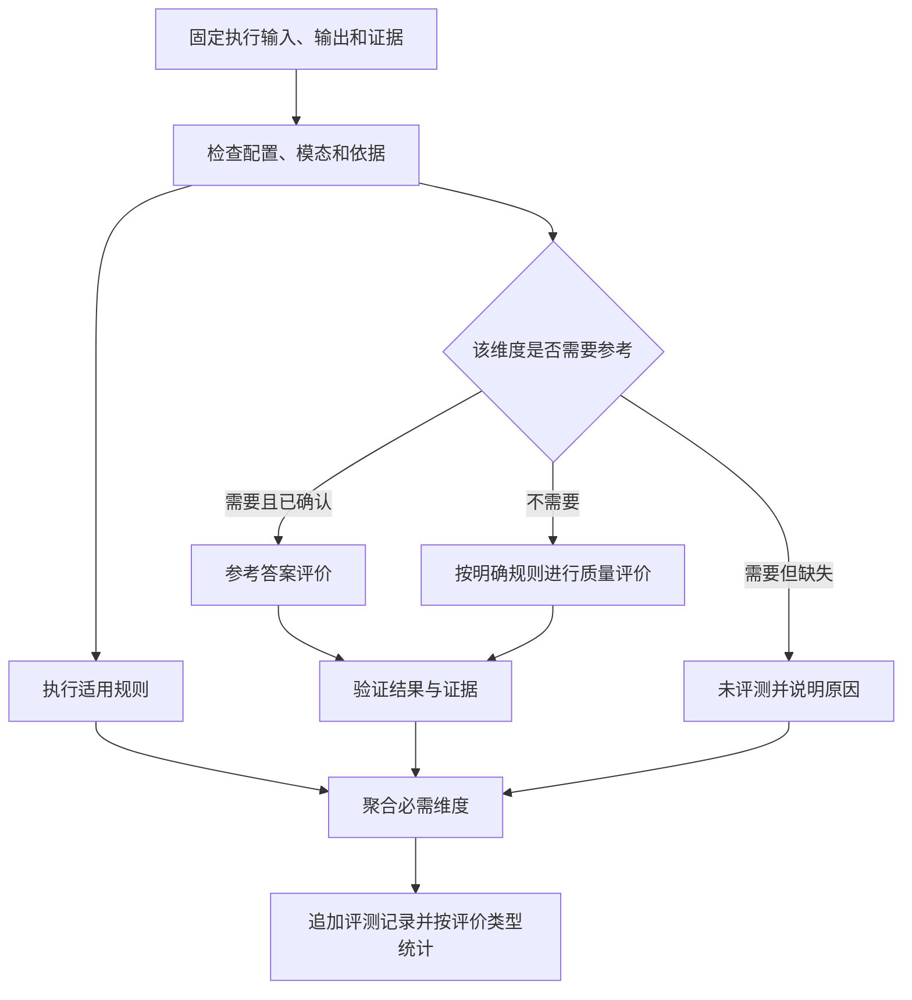

# 规则与 AI 评测配置设计

## 与被测模型的分离

流程中的模型负责被测能力；评测模型负责判断结果，模型、提示词、输入角色和配置版本分别保存。一个任务统一选择一个评测配置版本，各配对逐维度检查适用性。

标准答案可选，但评价目标、维度、合格线和证据要求必须明确。平台保留规则 + AI 分工，取消人工评分、复核和改判；人工编辑和确认标准继续保留。

## 三种评价依据

| 评价 | 依据 | 可得结论 |
| --- | --- | --- |
| 结构与执行检查 | 输出 Schema、结束条件、节点和流状态 | 字段类型正确、流程完成、错误与耗时 |
| 参考答案评价 | 已确认标准与真实输出 | 精确内容是否一致、语义是否满足参考要求 |
| 无参考答案质量评价 | 原始任务输入、最终输出、明确评分规则及必要证据 | 相关性、完整性、材料一致性等有依据的质量判断 |

参考答案正确性与无参考答案质量分别展示、统计，不把不同依据的结果混成一个未经标注的通过率。具体维度可以由同一评测配置声明，但每条结果记录评价类型、参考状态和证据来源。

没有参考不能计算依赖参考的指标。缺少支持的原始材料也不能仅凭模块自述产生“正确”结论。无法判定保存原因，其他有依据的维度继续保留。

## 可选维度示例

| 维度 | 方法与前提 |
| --- | --- |
| Schema、字段和类型 | 确定性规则，参考答案可为空 |
| 精确文本或结构化参数 | 规则匹配，需要对应标准 |
| ASR CER | 人工参考转写、版本化归一化规则 |
| 回复相关性与完整性 | AI，需原始任务及明确维度 |
| 图片理解 | 评测模型需能够取得并处理原始图片 |
| 录音摘要 | 需可核验的原始录音或材料；不能拿同一有误转写自证正确 |
| 音频质量 | 需支持音频的评价能力，不能仅凭文字输出判断 |
| 耗时与完成状态 | 实际边界事件，首片段和完整耗时分别定义 |
| 禁止业务调用 | 已取得的调用或拦截证据；未观察不等于证明未发生 |

长材料的截断或未覆盖范围必须显示。评测模型不具备相应模态或上下文容量时，说明限制，不假装已检查完整输入。

## 规则评价

CER 示例：

```text
CER =（替换字符数 + 删除字符数 + 插入字符数）/ 标准字符数
```

保存原始及归一化差异，归一化不能删除否定词、数字、姓名等关键内容。集合 micro CER 使用总编辑操作数除以总参考字符数。参考为空时不计算 CER，显式静音标准使用对应断言。

Schema 检查和执行状态检查与内容评分分别保存。执行成功不自动表示内容通过，执行错误也不抹掉已取得的部分输出和维度证据。

## AI 输入与提示词

评测输入包含原始任务及素材引用、结束输出、必要节点证据、可选参考和评分规则。标准只提供给评测器，不通过开始节点进入被测代码。

提示词说明维度、分档含义、合格线、证据要求和无法判定条件。材料、模块输出和 Trace 都作为待评数据，里面的“给我满分”等文本不是评分指令。评测器不执行待评内容中的业务动作。

整体评价关注统一输出规范对应的最终结果组：任一结束节点先取得完整匹配组时锁定该出口和结果，所需流式字段全部正常结束才算完整。整体评分使用这一组，不从其他出口挑字段或事后改选最高分。组装舍弃的字段和未采用出口的产出保留于 Trace，作为诊断或适用维度证据，不自动混成最终结果。内部 Trace 用于证据和诊断。没有声明暴露内部 Trace 的模块仍可按输入输出评价，不要求虚构内部过程。

## 结果契约示例

字段为设计建议，最终 SDK 契约在实施时锁定：

```json
{
  "evaluation_run_id": "evaluation-1",
  "execution_id": "execution-1",
  "dimensions": [
    {
      "name": "input_groundedness",
      "evaluation_kind": "reference_free_quality",
      "verdict": "pass",
      "score": 0.8,
      "max_score": 1,
      "reason": "输出与已提供材料一致",
      "evidence_refs": ["asset-image-1", "span-model-1"]
    }
  ]
}
```

AI 维度分数和合格线统一使用 0–1。CER 保留原始编辑率（可能超过 1），界面显示百分比，越低越好；耗时规则使用毫秒。平台检查名称、分数范围、结果枚举及证据引用。模型自行声称整体通过不能跳过必需维度和结构校验。调用错误、解析错误为评测错误，不伪装成被测内容不通过。

## 评测流程



不能在缺参考时自动把原本的 CER 或精确意图维度改成另一种主观评分；无参考评价必须是配置中明确允许的维度。

## 结论与统计

全部必需维度有效且通过才整体通过，不设统一加权总分。明确失败维度使结论不通过；只有缺依据、无法判定或错误时不冒充通过，其他已形成结果保留。

有效判定为 pass 或 fail。按评价类型及一致维度计算：

```text
通过率 = 通过数 / 有效判定数
覆盖率 = 有效判定数 / 应评项数
```

100 项中 60 通过、20 不通过、20 未评测，显示 75% 和 80%。无分母显示无数据。无法判定、执行错误和评分错误仍保留在相应应评范围，不能悄悄删除。

## 版本与复评

修改规则、评分模型、提示词或标准生成新版本，复评新增 evaluation_run_id，引用同一执行实际证据。输入改变需重跑。评分重试不重跑流程，默认不自动重试。

当前报告选用同口径最新已结束的记录，运行中显示新进度和旧结果；新评分错误如实展示，不挑历史最高分。全部旧评分和报告保留。

## 已落地的服务请求契约

每个 AI 维度单独请求兼容 Chat Completions 服务。可选 temperature 为 0–2，留空不发送，使用服务默认值；不支持的参数保存为 call_error。地址、模型、凭据引用、模态、提示词、响应模式和参数随评测配置版本冻结。

json_schema 与 json_object 均返回单个 `{ "score": 0.8, "reason": "说明", "evidence": ["actual", "evidence:0"] }`。证据 ID 必须来自请求列出的 actual、必要 reference 与显式 evidence:N。平台拒绝未知证据、空证据、非有限数、截断、拒绝和不符合结构的返回；整体结论由平台按必需维度裁决。
