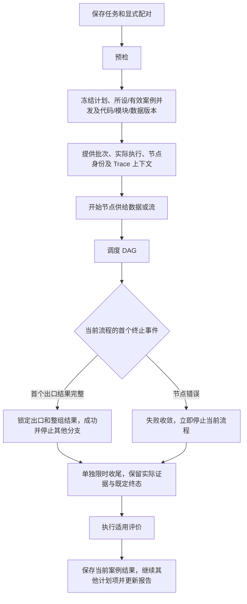

# 测试任务、显式配对与报告设计

## 创建任务

任务保存一次批量测试的显式配对、版本、评测配置和计划。每行配对选择一个测试集版本与一个 DAG 流程版本，同一集合可配对不同流程。任务统一选择一个评测配置版本，不自动展开额外交叉组合。

当前案例没有平台多轮步骤；每个计划项调用一次流程。模块可能根据执行上下文和自己的参数使用历史或缓存，平台不实现历史存储或承诺自动重置。

## 预检

| 项目 | 检查 |
| --- | --- |
| 数据 | 有序命名字段、类型、格式、所有必需输入资源 |
| 输出 | 测试集预期结构与结束输出需求 |
| 流程 | DAG、普通节点整组唯一前置、组装映射、全部结束节点统一规范和供给模式 |
| 模块 | ZIP 版本、平台 HTTP/WebSocket 契约、动态配置参数、后端运行要求及本地/Docker 启动设置 |
| 运行依赖 | 按模块声明准备；声明仓库依赖时同步并固定 commit，不按内部调用方式推断仓库要求 |
| 评测 | 模态、参考需要、维度适用性、证据及无参考质量目标 |
| 环境 | 模块执行边界、超时、并发与已声明状态行为 |

结构不兼容在执行前阻止并定位字段。用户修正或明确排除后才形成计划；执行中出现错误不从分母删除。

## 计划与计数

同一测试集版本内部的相同案例修订只保留一次。不同配对即使使用相同案例和流程仍独立执行，保留各自来源。

```text
计划数 = 各显式配对的（集合内去重后的有效案例数 × 重复次数）之和
```

例如 A 有 100 案例、B 有 80 案例，配置 A → 流程1、B → 流程2，各重复两次，计划为 360。不会执行未选择的 A → 流程2。重跑新增尝试，不增加计划数；评分重试不增加尝试数。

模块有批次共享状态时，重复执行不天然是独立样本。Q54 已确认任务默认同时执行 1 条案例，可调整；模块声明必须顺序执行时限制串行。历史状态仍由模块控制，报告展示配置、声明及生效约束。

## 案例并发与图内分支

案例串行：案例 1 的流程结束后再启动案例 2。案例并发：同一任务同时推进多条案例的流程，例如同时运行案例 1、2、3，每条仍有自己的 execution_id、输入、Trace、结果和评分；不会把三条案例的字段混成一条输入。

| 层级 | 例子 | 含义 |
| --- | --- | --- |
| 案例串行 | 案例 1 完成后跑 2，再跑 3 | 一次运行一条案例流程 |
| 案例并发数 3 | 先跑 1、2、3，一条完成后补入 4 | 最多三条案例流程同时活动 |
| 单条案例内的分支 | 一份输出供给模块 A 和模块 B | 仍是同一个 execution_id 中的 DAG 分支 |

ASR → 模型 → TTS 的依赖顺序在每条案例中仍须遵守；同时运行多条案例不允许 TTS 跳过其前置输入。案例并发设置控制同时活动的独立案例流程数，图内独立分支仍可并行；两者分开解释，不把图内 Span 数当作案例并发数。

模块若按 batch_id 共用历史/缓存，后启动的案例可能在前一条结束前读取或更新同一状态。是否允许并发取决于模块行为；平台仍不保存或自动清空历史。

Q54 已确认任务提供“同时执行案例数”，默认 1，允许设为 2、3 等正整数。任务创建时读取所选模块版本的顺序要求；任一所选流程模块声明必须顺序执行时，该任务有效案例并发数为 1。界面显示所设值、实际生效值及限制原因，用户不能通过调大任务值绕过声明。

正常情况下，每条案例结束后调度下一条，直到计划完成；某案例失败仅影响该案例，用户取消任务才停止全部计划。Q57 确认逻辑结束后单独限时收尾，实际停止按证据记录；收尾到期终止平台可控执行，不改判已确定结果。运行资源和调度名额如何衔接在执行契约中细化，不声称模块已经实际停止。

配置值、模块顺序声明和有效案例并发数固定到任务快照及报告。案例输入、Trace、结果与评分分别保存，批次/执行/节点身份仍按 Q46 区分。模块自行维护缓存，平台不保存或自动重置历史。

## 快照

| 内容 | 固定信息 |
| --- | --- |
| 配对 | 测试集、流程版本及成员案例修订 |
| 输入与输出需求 | 命名有序 Schema、资源摘要、实时输入来源 |
| 可选参考 | 内容、确认状态、参考版本 |
| 流程 | 整组 Schema、分发连线、组装映射、转换版本、统一输出及首完整出口/正常流结束规则 |
| 模块 | 包 ID、版本、摘要、前端入口、语言无关运行入口及参数 |
| 模块运行 | 实际选用的本地语言/入口/启动调用，或 Docker 镜像/仓库挂载/容器目录，声明依赖与平台契约；业务参数按模块 Schema 固定 |
| 仓库 | 地址引用、配置分支、实际 commit 和运行环境身份 |
| 评测 | 唯一配置版本、规则、模型、提示词、合格线 |
| 执行 | 所设/有效案例并发数、模块顺序声明、节点超时相关设置、收尾期限配置、状态参数及执行边界 |

凭据正文不进入快照或 Trace。仓库更新只影响新的代码绑定，运行中的任务与旧执行不切换共享分支目录。

实时输入开始时固定声明和来源，接收中追加实际数据，结束时固化资源；已经取得的片段不覆盖，采集完成后输入快照固定。

启动方式不改变计划项身份。模块服务准备与单次案例执行分开，启动复用范围遵守模块状态/顺序声明；停止单次执行不自动关闭共享模块服务。平台终止适配进程或容器后，模块内部活动仅按模块上报的取消证据展示；内部调用方式不属于平台运行分类，凭据正文不进入快照。

## 执行流程



Q53 允许平台为每个节点设置超时，Q55 将超时相关设置放在流程界面，超时作为节点错误。Q36/Q47 明确：节点错误立即停止当前案例的流程，保存错误和已有证据；批量任务继续其他案例，不取消同批计划。100 条中第 3 条失败，其余继续；用户取消整个任务才停止全部计划。

每个结束节点只接一个完整来源组，所有出口共用规范。Q49–Q51 明确：任一出口先取得完整匹配组即成功并停止其他分支；所需流式字段全部正常结束才算完整。节点错误先到仍失败，正常结束后的取消异常不改判。

同任务共用 batch_id，每个计划项每次实际执行有独立 execution_id，重跑新增；node_id 区分图节点实例。三层身份传给模块，由模块自己选择缓存键。

任务执行进度与评分进度分别展示。单次流程的逻辑终态和活动节点实际停止也分别保存。

## 状态

任务可表示 draft、queued、running、completed、completed_with_errors、canceled，具体 API 枚举是工程建议。单次执行至少区分待执行、运行中、成功、错误、取消和停止收尾；停止收尾作为执行终态之外的实际活动状态。

成功后未使用分支被取消不算新的流程错误。先收到错误的执行不因其他分支晚到输出改成成功。错误保存节点、代码、已有输出和停止原因。

## 报告

按流程/配对展示计划总数、待执行、运行中、完成、错误、取消，另列评分状态及任务所设/有效案例并发数和顺序限制来源。内部子 Span 数量、资源数、尝试数不作为计划数。

通过率 = 通过 /（通过 + 不通过）；覆盖率 = 有效判定 / 应评项。参考答案正确性与无参考答案质量按类型分开展示，维度覆盖也说明适用范围。错误、无法判定、缺参考、不适用单列，不静默丢弃。

任务使用统一评测配置，但不把不同评价类型当作同一统计口径。执行成功、评分成功和结果通过是不同状态。

## 对比与选用结果

按相同案例修订、重复序号、兼容环境及相同评价口径比较，显示共同样本量和各自 Trace。模块缓存配置、回放速度、流式/非流式、实际模型身份有差异时展示，不能声称条件完全相同。

当前结果使用同口径最新已结束执行及其最新已结束评分。新记录运行中同时显示进度与旧结果，结束后采用新结果；错误不退回旧成功，也不挑最高分。报告保存选用 ID 的快照，全部旧记录保留。

## 取消与重试

用户取消停止发放新计划项，并请求活动模块取消。活动执行使用独立收尾期限，到期仍未退出则记录收尾超时并终止平台可控执行。实际收尾与已确定的成功、失败或取消结果分别展示，后续事件不改判；远端未确认停止时如实显示未确认，已有证据保留。

默认不自动重跑或评分重试。重跑新增 execution_id（旧文档 execution_attempt_id 的单次尝试含义），仅重评新增 evaluation_run_id。模块是否利用新旧 ID 复用历史由其代码与配置决定，平台不替模块恢复缓存。

系统重启后核对未终结记录，不自动重发全部运行项。无法恢复的执行保留中断证据，由用户决定重跑。

## 验收

仅执行所选配对；严格输入匹配；结束必需输出齐备；首节点错误停当前流程但继续其他案例；同时执行案例数默认 1、可调整且受模块顺序声明约束；身份分层传递；报告准确区分状态和评价类型；重跑不扩大计划分母；代码同步不影响旧版本；批次状态行为不被平台伪装成独立无状态执行。
