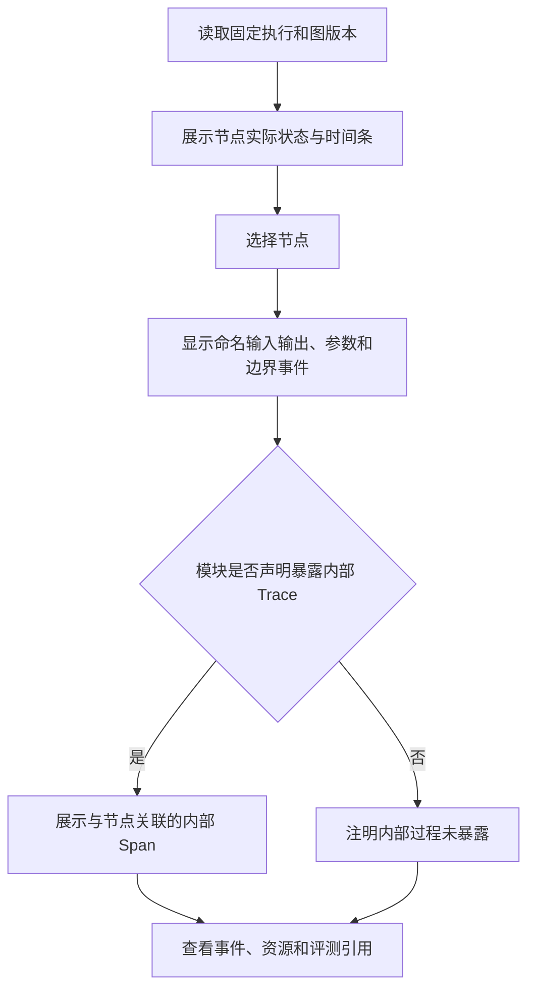

# 执行历史与多模态详情设计

## 统一入口

批量任务、流程快速测试和实时输入使用同一执行记录和详情页。任务详情提供本批次视图，全局历史提供跨任务查询。当前结果与全部尝试切换，不覆盖旧记录。

## 筛选

| 条件 | 依据 |
| --- | --- |
| 任务、配对、测试集 | 固定 task_id、配对和版本来源 |
| 案例 | 案例修订、名称及输入结构 |
| 流程 | 流程、版本、节点所用模块 |
| 仓库 | 仓库身份、分支声明和实际 commit |
| 模块 | 包 ID、版本、参数及能力 |
| 输入/输出 | 模态、字段、完整数据或流式 |
| 状态 | 执行终态、实际收尾、评测状态、评价类型及判定 |
| Trace | trace_id、span_id、暴露状态、错误节点 |
| 分类、标签、时间 | 执行快照的筛选信息 |

快速或实时执行没有集合来源时显示未关联，不虚构测试集 ID。之后创建素材或案例的派生关系不改写原执行。

## 详情布局

```text
┌──────────────────────────────────────────────────────────────┐
│ 执行 ID / 任务与配对 / 流程版本 / 终态 / 收尾状态 / 评价类型    │
├─────────────────────────────┬────────────────────────────────┤
│ 按命名字段展示输入           │ 结束节点所需输出及实际结果      │
│ 音频播放、文字、图片预览     │ 文字、图片、音频与完整性        │
│ 可选标准单独展示             │ 规则与 AI 判定摘要              │
├─────────────────────────────┴────────────────────────────────┤
│ commit / 模块版本 / 参数 / 总耗时 / 首片段耗时 / 停止原因       │
├──────────────────────────────────────────────────────────────┤
│ 执行过程 / 输入输出 / 评测 / 配置快照 / 原始事件               │
├────────────────────┬─────────────────────────────────────────┤
│ DAG 与实际时间线    │ 节点端口数据、参数、事件、错误与资源      │
│ 声明暴露的内部 Span │ trace_id / span_id / parent_span_id      │
└────────────────────┴─────────────────────────────────────────┘
```

不显示平台多轮步骤或 Turn 切换器。模块暴露的内部 Span 可以包含其自己的历史或会话事件，但不意味着平台管理会话。

## 输入与输出

输入按 Schema 顺序和字段名展示，两个 Text 分开，标准不混入输入。输出按完整结果组逐项说明应收、已收、缺失、流式中、是否正常结束、是否被截断。多个结束节点各自展示状态和唯一来源，全部对应同一输出规范；最终结果锁定首个取得完整匹配组的出口，显示该节点和来源 Span；其他出口的实际产出只作为相应证据保留，不逐字段混入最终组。

要求文字和音频时，文字已到、音频未到仍未满足结束条件。所需流式字段全部收到正常结束标记才算完整，首片段只表示已有内容。提前截断不满足结束条件；因另一出口已成功而取消的流显示取消/截断，不把整体成功改成失败。

无标准可查看质量评价及证据。依赖参考的维度缺标准显示未评测，不能把全部无标准执行写成统一 unscored。

实时录音与已生成媒体保留可用部分及完整性，历史资源隐藏后仍可播放。未保存或实际不可读取的资源说明异常，不伪造预览。

## 执行摘要与终态

节点详情显示在流程界面配置并固定到执行快照的超时相关设置、实际计时证据及超时错误，区别于模块自己的服务异常。超时按节点错误停止当前案例，批次仍继续其他案例。

摘要分别显示逻辑结果和活动节点收尾：已确定的成功、失败或取消保持不变；停止请求、实际停止确认、仍在收尾或收尾超时单独展示。详情保留收尾期限、实际时长、可控执行终止与远端状态证据。收尾到期不改判，未确认远端停止时不显示为已停止。

先错误则失败，不等待另一个分支；先满足结束条件则成功，随后为停止其他节点产生的取消异常不改判。晚到事件保留但标记发生在终态之后，不重新选择最终结果。

结束节点、触发结果组、触发事件及来源 Span 可定位。不同出口结果不逐字段混用。未启动节点显示流程已结束或失败，不把未运行节点计作 0 毫秒成功。

## Trace 与节点详情

平台节点边界始终记录。普通节点展示单个前置来源及完整输入/输出组；组装节点额外展示各来源组、字段映射、选用和未传下游字段、等待及输出目标 Schema。同一上游产出分发的多条链路关联同一个来源节点 Span，不虚构重复上游调用。未选字段的原始产出仍在来源节点中可查。模块没有声明内部 Trace 时显示未暴露，不显示“平台已取得全部内部调用”。声明暴露后展示其主动推送并关联的内部 Span。



并行和流式重叠按实际时间展示。总耗时不等于所有 Span 之和，推理耗时只在有相应证据时显示。

node_id、节点 Span 和原服务 Span 分别标明来源。资源以引用加载，大文本和原始事件分页/折叠，列表不一次读取全部历史。

## 评测详情

展示维度、评价类型、参考状态、分数、合格线、规则或 AI 来源、理由、证据和模型/提示词版本。点击证据跳到节点、事件或原始素材。

执行完成、评分完成和通过分别展示。评测错误、无法判定和内容不通过有不同含义。没有人工改判入口；标准或配置修订通过新增复评记录处理。

新执行/评分运行中显示进度与旧结果，结束后采用最新记录，错误也如实显示。可查看全部旧执行、评分和报告。

## 状态与缓存可见性

平台展示传入模块的 batch_id、execution_id、node_id、Trace 身份及参数，但不管理内部历史。任务详情显示所设及有效同时执行案例数、模块顺序声明和限制原因，便于解释同批执行顺序。模块是否使用缓存、缓存命中是否暴露由其契约与配置决定；未暴露时标记未知，不假设每案例自动清空或能重建内存状态。

## 验收

任务与全局历史打开同一执行；多模态字段清晰；所需输出和停止原因可定位；内部 Trace 严格按声明展示；终态之后取消不改判；所有旧版本和历史媒体保留；有标准与无标准评价分别说明依据。
