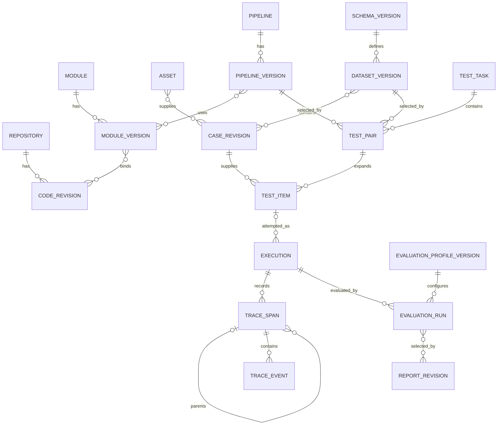
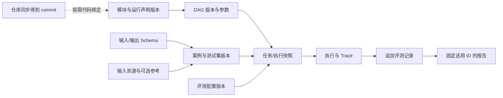

# 核心数据关系、执行身份与版本设计

以下为逻辑对象，平台使用 PostgreSQL 18、SQLAlchemy async 和 Alembic；独立身份与不可变版本分层保存。

## 对象

| 对象 | 标识示意 | 内容 |
| --- | --- | --- |
| 仓库 | repository_id | 地址、访问凭据引用、分支、同步状态 |
| 代码版本 | repository_revision_id | 仓库、实际 commit、可用目录、依赖身份 |
| 模块包/版本 | module_id、module_version_id | ZIP 摘要、manifest、前端入口、语言无关运行声明、平台 HTTP/WebSocket 契约、端口与参数 Schema |
| 资源 | asset_id | 音频、文字、图片内容、格式、摘要和完整性 |
| 素材修订 | sample_revision_id | 来源、标签、原始结果及可选标准 |
| 输入/输出结构 | schema_version_id | 有序唯一字段名、类型和约束 |
| 案例修订 | case_revision_id | 输入绑定、预期输出结构、可选参考 |
| 测试集版本 | dataset_version_id | Schema 与固定案例成员 |
| 流程版本 | pipeline_version_id | DAG、完整组 Schema、组装映射、转换版本、参数及统一输出/结束策略 |
| 测试任务/配对 | task_id、test_pair_id | 显式配对、统一评测配置、所设/有效案例并发及顺序限制来源 |
| 计划项 | test_item_id | 案例、流程、配对和重复序号 |
| 单次执行尝试 | execution_id | 当前执行及终态；旧名 execution_attempt_id 对应这一层 |
| 观察 | trace_id、span_id、event_id | 执行根、节点及主动暴露内部事件 |
| 评测/报告 | evaluation_run_id、report_revision_id | 固定配置、参考、结果和选用记录 |

Q46 已确认同时向模块提供 batch_id、execution_id、node_id。batch_id 同任务共用，可映射任务批次；execution_id 表示每条案例的每次实际尝试，重跑新增；node_id 表示固定图版本中的节点实例。三者与 trace_id/span_id 分层保存，模块自己选择缓存关联键，平台不将批次、节点 Span 和单次尝试混为一层。具体 SDK 获取接口在实施时锁定。

## 关系

快速执行可以没有 test_item_id，实时输入可以没有预先存在的案例修订，但必须保存实际输入及来源。平台没有对话步骤、会话历史库或人工裁决对象。

## Schema 与资产

Schema 用字段数组表示顺序，实际 inputs 按字段名绑定资源或文字值，不依赖 JSON 对象键顺序。标准与 inputs 分开。

普通连线引用来源节点的完整输出组与目标节点的完整输入组，不保存逐字段跨来源连接。组装节点保存各来源组、目标 Schema 和显式字段映射。流程版本保存一份统一 output_schema_version_id，所有结束节点引用它，每个只有一个前置；具体字段名为数据契约示意。

组装未选字段只从下游目标组省略，来源节点输出、资源及 Trace 仍保留。结束节点数量与来源关系随图固定，执行保存首个完整出口身份、整组结果及终止事件。所需流正常结束才可选用，晚到出口不覆盖。分发连线引用同一上游产出，不生成重复上游执行记录。

流式是供给方式，测试集保存完整素材。开始节点声明其流式输出，实例化执行时记录回放参数或实时来源。已保存片段不覆盖，输入结束后封存资源。

资产可复用，执行不能跨配对复用。原始、转换和输出资产保留来源关系，不用一个资源 ID 覆盖不同阶段内容。

日常素材引用与执行证据分层：测试集当前案例按稳定素材 ID 解析最新修订；任务创建时一次冻结实际输入与显式绑定的素材参考，同一计划内同一素材使用同一解析结果。排队、重跑及历史报告不重新解析最新素材。素材更新新增不可变修订，支持文字正文及对应文件一起更新；原有文件和摘要继续保留。

2026-10-12 最新边界移除案例输出与标准答案。新任务只冻结输入，参考与参考来源为空；既有执行继续保留原快照。任务报告的 `materials` 返回冻结输入 Schema、素材、输出 Schema 和所选执行的实际输出，供列表展示；旧报告缺少该展示字段时前端读取其固定选用执行。

## 版本冻结

每次执行按模块声明固定代码依赖 commit、模块包摘要、图、参数、各节点超时相关设置、收尾期限配置、输入、参考和评测版本。分支名称只是声明来源，不能代替实际 commit。不同执行使用不同版本时不得切换同一活动工作目录。

前端配置组件版本跟随 ZIP 和模块版本固定；旧流程不能加载新包界面后悄悄重写参数。新包、代码、参数或 Schema 更新创建新版本。

快照不保存凭据正文。请求服务的实际模型/代码身份与本地仓库 commit 分别保存，本地 SHA 不能证明远端使用相同代码。

运行快照固定 Pod 镜像声明及实际 imageID、代码挂载仓库/commit、容器绝对目录、复用范围、模块版本和参数。全部模块使用镜像 ENTRYPOINT/CMD，没有本地语言或运行入口字段。平台没有来源枚举、通用外部协议或服务地址字段；模块内部实现自行决定。

## 模块内部状态

平台传递执行上下文，缓存及历史由模块实现和配置。平台固定参数及可取得的状态声明，不复制内部对话历史，也不保证仅凭 ID 能恢复模块内存。

若模块把同一批案例关联为共享缓存，会影响执行顺序、并发及结果解释；这些行为需要在模块契约和报告中明确，不默认视为独立无状态实验。模块可自行配置缓存行为；Q54 确认任务默认同时执行 1 条案例、可调大，模块声明必须顺序执行时任务限制为 1。所设值、模块版本声明和实际生效值保存到快照；声明如何表达及状态作用范围在 SDK 中细化，平台不推断隐藏内存。批次、尝试、节点身份按 Q46 提供。

## 历史与选用

全部素材、包版本、代码版本、执行、事件、评分和报告保留。删除只隐藏并阻止新选，不级联清理旧引用或媒体。

同一计划项采用同口径最新已结束的尝试及评分，运行中显示新进度与旧结果；结束后选用新记录，错误不回退为旧成功。重试不增加计划数，复评不增加执行数，旧报告选用快照不改写。

新参考可评价旧执行，但必须对应实际原输入；输入改变需重跑。无参考质量与参考答案正确性使用不同评价类型，汇总不混口径。

## 一致性

- 同一集合相同案例修订去重，不同配对独立展开。
- 每次执行终态只收敛一次，后续事件保留且不改判。
- 单条案例失败不删除计划项或取消其他案例，用户取消任务才停止全部计划。
- 已确定成功、失败或取消终态保持不变；实际停止收尾、独立期限、收尾超时及终止证据分别保存，远端状态据证据记录。
- 内部 Span 仅在模块声明暴露并关联上下文时收集。
- 文件长期保存，隐藏资源仍能由历史固定 ID 读取。
- 参数、Schema 和模块版本的兼容校验不以 UI 已成功加载代替。
