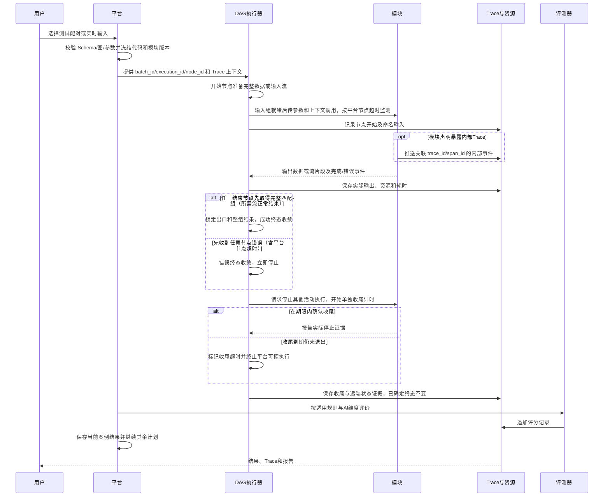
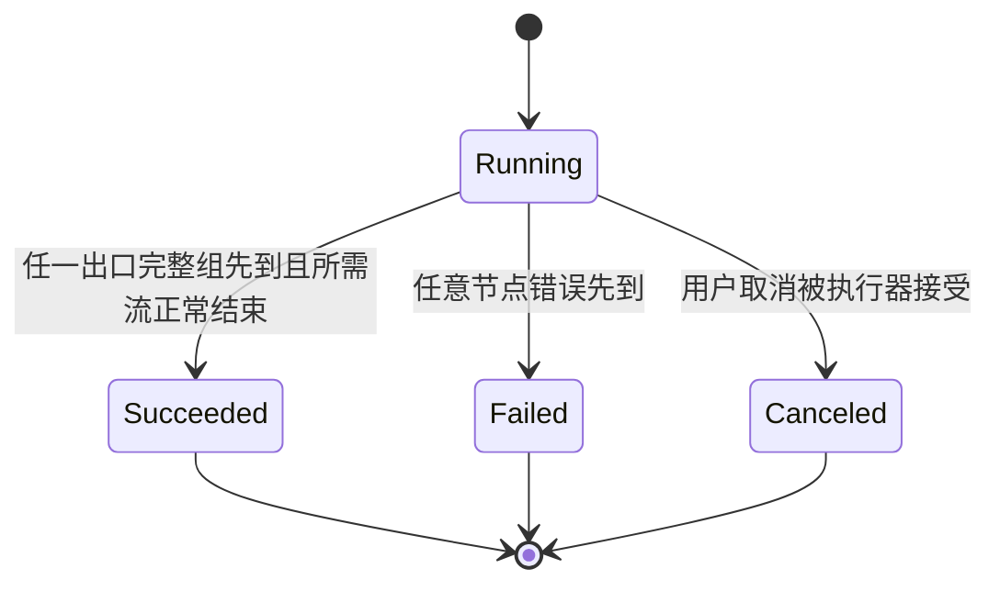

# DAG 执行、流式端口与 Trace 设计

## 执行流程



图描述执行目标，不代表现有模块已实现统一协议。平台与模块的 HTTP / WebSocket 方式已确认；具体 SDK 和媒体流消息在实施前确定。

## 语言无关模块运行与通信

平台按模块声明准备本地进程或 Docker，完成就绪检查后通过 HTTP 管理单次执行，WebSocket 传递流式字段与相关事件。模块服务启动与案例调用分开；具体 HTTP 路由、消息字段、端口发现、构建/依赖准备和复用范围在工程契约中锁定。两种启动方式共用模块协议，不限定后端语言。

平台只发起模块执行，不区分模块内部使用外部接口、仓库代码或其他实现。私有 WebSocket 的初始化、ready、数据格式、增量/累计消息、正常完成、错误和取消由模块代码处理，并映射为统一模块事件。平台不提供通用外部地址/协议配置，也不猜测内部调用。停止模块进程或容器只证明平台可控部分停止，内部活动状态按模块上报证据保存；收尾期限和既定终态规则继续有效。

## 端口与数据

输入/输出组声明有序字段，各字段含唯一名称、逻辑类型、格式及流式属性。普通节点输入整组来自唯一前置，不能逐字段从不同来源补齐；每个结束节点也只有一个前置，并引用统一输出规范。只有内置组装节点可接多个来源组，按映射选择字段并组装目标组。

两个方向都不能直接跨流式/非流式模式连接。平台可提供内置生成流、收集为完整数据等显式转换模块，输出端声明转换后的模式；普通连线仍同模式匹配。字段组装本身不隐式转换模式，也不进行媒体内容转换。

完整数据以一次值或资源引用交付。流式数据需要可识别的片段顺序、格式、结束和错误信息；这是统一协议的工程需求，具体消息字段尚未确认。音频帧的采样率、声道、编码和时序必须声明，不能仅标记 Audio。

开始节点可以把测试集完整素材生成输入流。实时输入直接提供流式数据，同时平台保存已收到证据。回放节奏、切块和断连规则在工程契约中细化，不用任意 sleep 作为最终协议。供给过快、缓冲满和慢消费者处理按 Q56 暂缓。

## 调度

非流式普通节点在唯一来源的完整输入组就绪后执行；组装节点等待所选字段对应的必需来源组，按显式映射输出。每个字段记录来源，不按相同模态自动挑选。未选字段不继续派发，但保留来源节点实际产出的完整 Trace 和资源。

流式节点有准备、消费和正常结束三个阶段，组的连线完成或首片段到达不等于流内容已完整。Q51 已明确最终结果必须等待所需流正常结束；Q52 明确组装在所需非流式字段齐备、所需流可读取时启动下游，并持续透传各字段流。组装保留流式属性，不隐式收集成完整值，不自动按不同流片段编号对齐媒体；具体同步协议在实施时细化，缓冲策略按 Q56 暂缓。

Q50 允许同一产出整组分发多个下游，各下游逐字段匹配且只接唯一前置；分叉不重跑上游。流式分发的目标语义是每条活动链路接收同一来源内容，而非多个消费者竞争分走片段；各链路消费进度分别记录。Q53 确认每节点可设置平台超时，超时作为错误；流式供给过快、缓冲满和慢消费者策略后续由 Q56 明确暂缓，原有限缓冲及暂停上游建议不视为已确认。

Q54 明确任务“同时执行案例数”默认 1、可调整；任一所选流程模块声明必须顺序执行时，任务有效案例并发为 1。所设值、有效值、声明来源及实际顺序进入快照/报告。每条案例独立身份和结果，图内独立分支仍按 DAG 并行，不引入循环。

## 结束与错误

Q43–Q44 改为多个结束节点，每个唯一前置，使用同一输出规范。结束结果是一个前置的完整输出组，不按字段混选不同来源；需要文字与音频时其组内两者必须齐备。

Q49/Q51 确认：任一结束节点先取得符合统一规范的完整结果组，就锁定该出口和整组结果，使流程成功并停止其他分支。所需非流式字段具备完整值，所需流式字段全部正常结束；缺字段、首片段或提前截断均不算完整。后到结果保留 Trace，但不覆盖已选出口，也不跨出口混接字段。

任意节点报错立即停止当前流程，不等待独立分支成功。终态由平台接收到的首个有效终止事件决定：



成功后的取消异常、失败后的晚到输出不触发二次终态，保留为后续事件。Q57 明确已确定的取消结果同样保持不变。用户取消与成功/错误竞争的完整优先级仍在工程契约中细化，不把终态确定后的收尾状态重新用于裁决。

## 平台节点超时

每个节点可在平台侧设置超时；Q55 明确超时相关设置在流程界面配置，实际生效配置固定到流程和执行快照。超时生成节点错误，记录节点、配置、计时证据及已有产物，立即停止当前案例流程，批次继续其他案例。

平台计时与模块自带服务超时分别展示。起算点、计时范围、配置选项及默认模式在实现契约中细化，Q55 不等于接受原题固定计时规则。停止后的收尾使用独立期限，见下节；流式缓冲处理按 Q56 暂缓。

首完整结果已使流程成功后，其他节点因取消产生的晚到异常或收尾超时作为后续事件，不推翻终态；实际停止和资源释放继续单独记录。

## 停止与收尾

停止立即阻止启动新节点及继续派发数据，向活动模块请求取消并记录原因。逻辑终态与模块实际停止分开。

Q57 确认停止后的收尾使用独立期限，到期仍未退出则标记收尾超时，并终止平台可控制的执行。已确定的成功、失败或取消结果保持不变；取消异常、收尾超时和晚到输出只作为后续事件。实际收尾、超时及终止证据单独保存和展示。

模块需提供结束/取消能力声明，平台按实际证据记录。远端未确认停止时如实显示未确认，不把取消请求或本地执行终止当成远端已停。具体期限、可控执行终止方式、资源释放和调度名额衔接在实现契约中细化；不自动恢复模块缓存。

保留已经生成的输出、片段、Trace 和媒体。单条案例失败停止当前流程，批次继续其他案例；用户取消任务停止发放全部剩余计划并取消活动执行。因正常结束而未运行的节点说明原因，不标成功或虚构耗时。

## 执行 ID 与内部状态

Q46 确认同时传入 batch_id、execution_id、node_id 和 Trace 上下文。同任务共用批次身份，每条案例每次实际尝试有独立 execution_id，重跑新增；node_id 表示图中的节点实例。

模块自行选择批次、尝试或节点作为历史/缓存关联键，并可在动态配置界面控制行为。平台不实现对话历史或自动重置。共享缓存可能影响顺序和并发，模块的顺序声明由调度遵守，任务受约束时案例串行。声明和实际配置进入快照/报告；平台不读取或重建隐藏内存，具体 SDK 接口、状态作用范围和生命周期还需锁定。

## Trace 层级

平台统一采集执行根和模块节点边界：

```text
执行根 Trace
├─ 开始节点 Span
├─ 模块节点 Span
│  └─ 模块声明暴露并主动推送的内部 Span
├─ 内置组装节点 Span（来源组、映射、等待与结果）
├─ 内置流式转换节点 Span
└─ 各结束节点 Span（同一输出规范、各自唯一前置）
```

运行时向模块提供 trace_id、节点 span_id 和可用 parent_span_id 上下文，模块创建内部子 Span 时正确关联并继续透传。具体字段/API 是待锁定契约。

内部 Trace 必须在包中声明支持，只有声明暴露后平台才采集其推送内容。平台不会自动遍历所有函数，也不会因有日志文件就声称已获取完整链路。

模块内部事件缺失显示未暴露或观测不完整；没有证据不补造内部 Span。

## 事件和媒体

| 信息 | 内容 |
| --- | --- |
| 身份 | batch_id、execution_id、node_id、Trace、Span、父 Span、模块版本 |
| 时间 | 平台接收顺序、开始/结束、时钟来源 |
| 数据 | 完整组、分发来源、组装映射及取舍、流序号/完成/完整性、资源引用 |
| 状态 | 正常结束、错误、取消、未执行、停止后事件 |
| 来源 | 平台边界或模块主动暴露 |
| 配置 | 生效参数、节点超时相关设置、收尾期限配置及版本引用，凭据正文排除 |

媒体保存资源引用、格式、摘要和完整性，不把全部 PCM 或图片写入每条事件。模块输出与实际调用事件作为待评证据，不成为评测指令。

## 耗时口径

执行总耗时按执行起止测量，节点耗时包含实际等待与调用。并行 Span 不直接相加。首片段、完整输出、流结束和收尾时长分别显示；未知内部推理时间保持未知。

首片段性能并不代表输出完整。同步文件快速发送也不等于真实语速流式延迟，报告保留供给模式和时钟。

## 重试、历史和待决项

平台默认不自动重跑或重评，用户操作追加尝试或评分。服务内部既有重试保留实际策略，不虚构逐次 Span。

完整历史长期保留，逻辑删除不影响媒体播放。Q47 已明确单案例失败不取消其他案例，用户取消任务才停止全部计划。Q49–Q51 已确认首完整出口、整组分发及所需流正常结束。Q52 已确定就绪后传流，Q53 已确定节点超时为错误；Q54 已确认默认 1 的案例并发设置及模块顺序限制。Q55 将超时相关设置放在流程界面，Q56 暂缓缓冲处理，Q57 确认单独限时收尾及终态不变。具体计时选项、默认值、收尾期限、媒体及调度资源契约在实施时细化。
