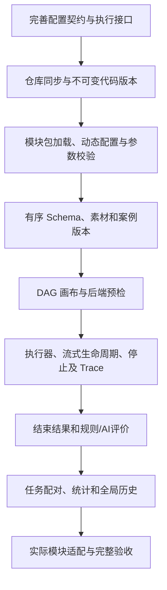

# 当前范围、实施顺序与验收

## 当前设计状态

最新范围是动态仓库、可信 ZIP 模块、命名多模态输入、流式端口和 DAG 的模块能力测试平台。旧 Q26 定稿仅对应旧语音方案，不能解释为新方案全部细节已经定稿。

Q30–Q63 的回答与状态已写入 QA。Q63 补充先选启动方式，本地选语言/入口，Docker 使用镜像启动命令并按需挂载代码，不要求本地入口。Q58–Q61 确认语言无关模块、Kubernetes Pod，以及平台 HTTP 管理/WebSocket 流式；Q62 明确内部调用方式由模块代码决定，平台不设置来源分类或外部连接固定字段。Q43–Q48 确认整组绑定、内置组装、多出口统一规范、身份及批次失败边界；Q49–Q51 确认首完整出口结束、同一产出整组分发及所需流正常结束。Q52 已确认就绪后启动下游并传流，Q53 确认每节点平台超时且按错误处理；Q54 确认任务案例并发默认 1、可调整，模块要求顺序时限制串行。Q55 将超时相关设置放在流程界面，具体选项与默认值在实施契约中细化；Q56 明确暂缓缓冲处理；Q57 确认单独限时收尾及终态不变，实际收尾单独展示。本轮不实现平台或修改原仓库代码。

## 交付范围

| 部分 | 能力 |
| --- | --- |
| 仓库 | 动态地址/凭据/分支配置、同步、固定 commit 与版本可用性 |
| ZIP 模块 | 包导入、契约、输入输出、动态前端配置、参数 Schema、语言无关运行入口及声明的运行依赖 |
| 模块运行 | Kubernetes Pod；HTTP 管理执行/WebSocket 传流；外部接口协议由适配代码处理 |
| 素材 | 音频、文字、图片资源与版本，实时录音归集、预览和标签 |
| 测试集 | 固定有序命名输入、输出结构、全部必填数据、可选标准 |
| 流程 | DAG、完整组连线、内置组装、多个结束节点/统一输出、参数及版本 |
| 执行 | 完整/流式数据、显式转换、实时输入、流程界面超时配置、首错误停止本案例、批次继续及独立限时收尾 |
| Trace | 统一边界、模块声明后主动暴露的内部 Span、链路 ID |
| 评测 | 规则 + 独立 AI、参考与无参考质量、证据、无法判定、复评 |
| 任务/历史 | 显式配对、统一配置、准确计数、最新结果、全部版本和媒体保留 |

平台不管理多轮会话步骤和模块历史，不需要硬编码固定内部流程或六种语音模块。ASR、模型、TTS、AEC、NS、VAD 是可导入能力示例，实际可执行取决于模块代码和来源能力。

保留唯一 admin、无人员记录、无人工评分裁决、不执行实际动作或被测业务写入、不建模拟业务验收端等未撤销边界。

## 实施顺序

优先用简单已适配模块打通闭环，再验证复杂流式与内部代码适配。原代码无修改不等于任何函数都可直接成为节点，适配验证是模块交付的一部分。

## 验收场景

| 编号 | 场景 | 预期 |
| --- | --- | --- |
| A01 | 添加两个仓库并同步 | 记录地址引用、分支、commit，凭据不进日志和快照 |
| A02 | 更新仓库分支 | 新测试可选新版本，活动和历史执行使用原 commit |
| A03 | 导入可信 ZIP | 可读取命名端口、参数 Schema、前端配置和语言无关运行声明 |
| A04 | 动态配置组件编辑参数 | 校验并保存模块参数，新流程版本生成 |
| A05 | audio、instruction、context、image 输入 | 所有案例数据齐备，两个 Text 分别绑定 |
| A06 | 字段顺序、名称或格式不符 | 预检拒绝并指出冲突 |
| A07 | 无标准案例 | 仍执行结构及适用质量评价，CER 等缺参考指标未评测 |
| A08 | DAG 分叉、环及缺来源 | 同一输出可整组分发，各下游契约匹配；循环及缺必需供给拒绝，上游不因分叉重跑 |
| A09 | 普通节点用 A.Text 和 B.Image 补齐输入 | 直接混接拒绝，组装节点显式形成匹配的完整组再供给 |
| A10 | 任一方向直接跨流式模式 | 拒绝；显式转换，开始节点可从完整素材生成声明输入流 |
| A11 | 一个结束节点要求文字和音频 | 唯一前置提供完整匹配组，两项齐备；若为流则两者均正常结束才满足 |
| A12 | 分支先错误 | 当前流程立即停止，不继续等待另一分支成功 |
| A13 | 结束先满足、后有取消异常 | 终态仍成功，取消事件及收尾单独保存 |
| A14 | 模块未声明内部 Trace | 边界可见，内部显示未暴露，不伪造全部过程 |
| A15 | 模块声明并推送内部 Span | 链路 ID 可关联，详情显示实际父子关系 |
| A16 | 模块执行上下文与缓存配置 | 三层 ID 可取得，批次共用、尝试独立、节点可区分；历史由模块控制 |
| A17 | 多条显式测试配对 | 仅执行所选关系，集合内去重、跨配对独立 |
| A18 | 执行重跑、评分重试 | 分别新增尝试或评测，计划分母不扩大 |
| A19 | 相同评价口径 60通过/20失败/20未评 | 通过率75%，覆盖率80%，缺失原因保留 |
| A20 | 参考与无参考结果 | 类型和依据明确，统计不混口径 |
| A21 | 实时输入取消或断连 | 可用录音保存并自动归集，完整性明确 |
| A22 | 隐藏资源、包或流程 | 管理中不可新选，旧版本、Trace和音频仍可读取 |
| A23 | 原仓库业务边界 | 模块实际覆盖和拦截可验证，不伪造业务成功 |
| A24 | 最新执行/评分错误 | 如实选用最新结果，旧记录和旧报告仍保留 |
| A25 | 新增多个结束节点 | 每个唯一前置、共用输出规范；不同规范或两个前置被拒绝 |
| A26 | A 输出 image/text、B 输出 audio/image | 组装显式选择并排序形成目标 audio/text/image，不自动挑同类型字段 |
| A27 | 组装未选来源字段 | 不传下游，原来源节点实际产出和 Trace/历史继续保存 |
| A28 | 100 案例中第 3 条错误 | 停止该案例并保留错误，其余继续；用户取消任务才停止全部计划 |
| A29 | 执行重跑时的身份 | execution_id 新增，同任务 batch_id 保持，node_id 对应固定图实例 |
| A30 | 多个合法结束节点竞争 | 首个完整匹配组锁定为结果并停止其他分支，后到结果不覆盖 |
| A31 | 流首片段与提前截断 | 首片段可展示但不算完整，所需流正常结束才可触发成功 |
| A32 | 同一综合输出分发后选择不同字段 | 内置拆分/选择得到各目标组，各下游完整匹配，来源只执行一次 |
| A33 | 组装输入含静态字段和流 | 所需静态字段齐备、流可读取时启动下游，持续透传；终端仍等正常流结束 |
| A34 | 平台节点超时 | 各节点配置固定到快照，超时为错误停止本案例，批次继续，已有证据保留 |
| A35 | 新建任务和调整案例并发 | 默认 1，可设 2、3 等正整数，案例独立身份和结果，计划总数不变 |
| A36 | 模块声明必须顺序执行 | 任务有效案例并发为 1，配置较大不能绕过，界面/报告说明声明来源 |
| A37 | 案例串行时图内分支 | 独立 DAG 分支仍可并行，不把 Span 数算成多条案例 |
| A38 | 流程界面配置节点超时相关设置 | 配置与模块业务参数分开保存，固定到版本/执行快照，历史显示实际配置及计时证据；具体选项和默认值依实施契约 |
| A39 | 停止后模块未在收尾期限内退出 | 标记收尾超时并终止平台可控执行；已确定成功/失败/取消不改判，实际收尾和远端状态据证据单独展示，已有产物保留 |
| A40 | 导入不同后端语言模块 | 按声明准备目标环境，平台不要求 Python 函数入口；输入输出仍统一校验 |
| A41 | 不同模块内部实现 | 平台采用相同模块契约，不要求选择外部接口、仓库或组合类型；代码依赖仅按运行声明准备 |
| A42 | 模块内部使用私有 WebSocket | 适配由模块代码实现，平台只接统一事件，不增加固定外部协议/地址字段；断连不冒充完整 |
| A43 | 容器模块由 Pod 启动 | 全部模块使用镜像 ENTRYPOINT/CMD，HTTP 管理/WebSocket 流式契约；快照固定镜像、运行摘要和可选代码挂载 |
| A44 | 模块声明代码依赖 | 平台准备并固定声明的代码版本；是否同时调用外部接口不改变启动方式、模块分类或 DAG 契约 |
| A45 | 停止适配模块或容器 | 保留既定终态及实际收尾；无外部取消证据时显示远端停止未确认 |
| A46 | Pod-only 配置与服务身份 | 没有启动方式、语言或运行入口选择；导入状态与运行可用状态分开，真实健康/契约及 imageID 校验 |
| A47 | Pod 镜像与仓库挂载 | 镜像 ENTRYPOINT/CMD 启动模块，固定 commit 只读挂载到容器绝对目录；挂载完成不能代替模块就绪 |

超时配置选项、默认计时规则、收尾期限值、可控执行终止与调度资源的具体协议在实现时细化，再补充相应验收细节；不只以画布可连线或表单可加载作为运行验收。Q56 暂缓的缓冲策略不纳入本轮验收承诺。

## 后续工程细化与暂缓项

- Q55 已回答：超时相关设置在流程界面配置；具体起算点、计时范围、选项及默认值留在实施契约，不将原题固定计时规则视为已接受。
- Q56 暂缓：流式供给过快、缓冲满及慢消费者处理，按用户要求先不讨论，从当前待回答问题移除。
- Q57 已确认：收尾单独限时，超时记录及终止平台可控执行，已确定终态不变；具体期限值、终止方式和资源释放留在实施契约。
- 分块、流同步、媒体传输、模块顺序声明表达及调度资源在工程阶段细化。

Q52 就绪后持续传流和 Q53 每节点平台超时继续有效；暂缓缓冲策略不改变已确认的流式能力或完整性规则。本轮没有新增待回答问题。

身份、失败案例继续批次、内置转换、首完整出口、整组分发及正常流结束已由 Q46–Q51 解决，不重复作为未决需求。

具体 SDK 名称、包打包形式、后端存储、运行准备/就绪/复用细节和容量是实施核实事项，不要求用户猜测原仓库是否已支持。

## 前端与验证

使用用户指定 React 19、TypeScript 7、Vite 8、HeroUI 3、Tailwind CSS 4 + Tokens、Router 7、Query 5、Zustand 5、Lucide、Fetch REST 和 Playwright/Node.js。

实施时验证真实依赖组合、动态组件与画布能力。Node.js 测试覆盖有意义的 Schema/图/统计逻辑，Playwright 覆盖仓库、模块、测试集、DAG、任务及详情交互。受控错误模块用于验证执行器与界面，不建设模拟业务验收端。

本文验收是目标清单，不是本轮已执行测试结果。

## 2026-10-11 原型全流程审查结果

本次检查对象是 [demo.html](../demo.html) 的桌面浏览器交互。资源接入 → 素材 → 测试集 → 保存 DAG → 测试任务 → 执行详情 → 重跑/复评 → 当前及历史报告，已完成模拟业务闭环验证。

| 页面/环节 | 实际验证的交互 |
| --- | --- |
| 工作台、通用入口 | 最新运行批次、排队项显示、按评测版本统计、搜索/空结果/跳转、8 步导览、快捷键、Escape |
| 仓库 | 地址校验、注册、同步、修改分支后重新同步、隐藏取消、隐藏与恢复 |
| 模块 | ZIP 文件选择及表单重绘保留、本地语言/入口、自定义语言、Docker 镜像/挂载校验、切换草稿、固定 commit、历史快照、顺序限制；契约示例只读及添加到画布 |
| 素材 | 本地文字/图片/音频导入、坏音频逐文件报错、已成功文件保留、参考确认校验、编辑、筛选/空结果、播放/停止、录音准备状态 |
| 测试集 | 字段增加/移除/排序、名称保留、嵌套案例编辑取消/X/Escape 返回向导、批量去重、案例编辑/移除、返回步骤、创建、名称与结构修订 |
| 流程画布 | 从零建立 DAG、完整组连接、参数/超时校验、缺映射/字段重名/循环/重复边拒绝、内置节点增删、断连、删边取消、键盘选择、拖动、缩放、保存/撤销、自定义快速输入、多模态执行、导出 |
| 任务/报告 | 添加/移除显式配对、案例并发、第 3 项失败后其余继续、任务取消、重跑进度与旧结果同时显示、当前/旧报告 |
| 执行/评测 | 历史筛选/清空、6 个详情页签、Trace、真实下载的 JSON、复评错误/恢复、旧评分查看、原评测版本复用、合格线生效、异口径评分不混入批次、CER 不适用 |

本次修正的主要问题：

- 在创建计划时冻结全部输入素材及文字，排队项不再到实际启动时读取当前素材；重跑保留原输入。完整性校验同时检查素材存在、类型、格式和必填文字。
- 当前报告选取最新已结束尝试，活动重跑另外显示；完成计数与计划分母保持稳定。报告评分按批次固定的配置 ID/版本选取最新已结束记录，评分错误不回退；复评可以选择仍保留的原版本。工作台分版本统计，质量合格线参与判定。
- 最终输出按声明字段顺序展示文字、图片、音频和流结束状态；完整文字输入不再被当成对象字符串。开始流及显式双向转换等待正常 EOS；没有 ASR 的流程将 CER 标为不适用。
- 补齐测试集修订、草稿案例编辑/移除、嵌套返回、名称保留、流程放弃修改和即时未保存状态。增加键盘可用的连线移除入口、已隐藏资源恢复、筛选控件名称和搜索空状态；编辑过程中搜索快捷键不会覆盖当前表单。
- 模块契约中的参数示例改为只读，实际编辑在流程节点完成。异步录音转换限制重复开始/提前提交，按输入结构绑定录音并避免更新已替换的弹窗；导入失败可以重试。仓库地址/分支变更使当前版本重新待同步，旧同步完成回调不能覆盖新配置。

验证结果：`node --test tests/*.test.cjs` 的 **17 项逻辑测试通过**；浏览器 **8 组全流程场景和 6 组模块运行配置场景通过**，另实际检查节点拖动、编辑中快捷键保护和无 ASR 严格评测。已生成并解析流程/执行 JSON 下载文件，保存完整批次报告截图；最终验证期间未观察到浏览器脚本错误。测试入口、合成文件及运行方法见 [tests/README.md](../../tests/README.md)。

这些结果确认单页原型的可操作闭环。真实 Git 同步、ZIP 解包及动态组件加载、Pod 启动、HTTP/WebSocket 模块连接、AI 评分、服务取消/收尾和持久化仍需正式实现与集成验收。麦克风实际采集未授予权限或录制，本轮只验证录音准备交互及相关代码保护；已验证真实本地音频导入和浏览器格式转换。原型使用预置契约模板，页面刷新恢复初始数据；中英文、深浅主题、HeroUI/React 正式前端尚未落地。本次没有将这些项目或 Q56 缓冲策略宣称为完成。
