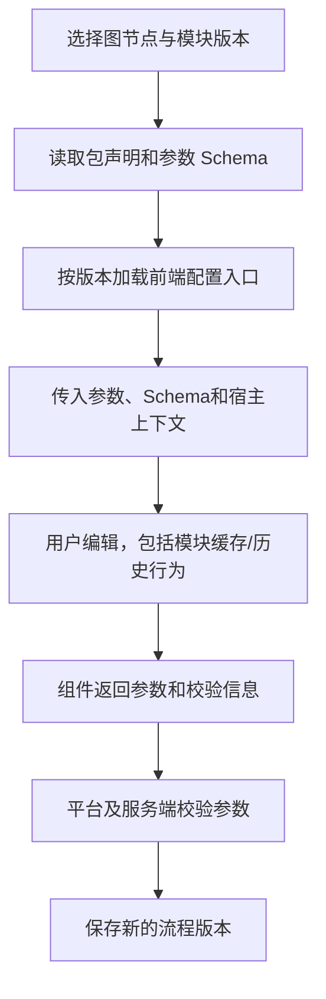

# 前端技术、DAG 画布与动态模块配置

## 指定技术栈

| 用途 | 技术 | 职责 |
| --- | --- | --- |
| 页面框架 | React 19 | 页面与动态配置组件宿主 |
| 开发语言 | TypeScript 7 | 页面、端口、参数和接口类型 |
| 构建 | Vite 8 | 开发与静态资源构建 |
| 基础 UI | HeroUI 3 | 按钮、表单、弹窗 |
| 样式与主题 | Tailwind CSS 4 + CSS Design Tokens | 平台和模块共同主题 |
| 路由 | React Router 7 | 页面、版本、执行和筛选定位 |
| 服务端数据 | TanStack Query 5 | 查询、缓存、刷新和写后同步 |
| 客户端状态 | Zustand 5 | 语言、主题等偏好 |
| 图标 | Lucide React | 导航和状态辅助 |
| 管理接口 | Fetch REST API | 仓库、包、流程、任务、结果查询与操作 |
| 测试 | Playwright E2E + Node.js 测试 | 关键交互和必要纯逻辑 |

以上是用户指定主版本，尚未安装或完成兼容验证。画布实现与媒体传输协议另行确定，不在本轮增加依赖。

## 页面和路由建议

| 页面 | 路由 | 交互 |
| --- | --- | --- |
| admin 登录 | /login | 唯一账号，无个人注册 |
| 仓库 | /repositories | 地址/凭据/分支、同步和版本 |
| 模块 | /modules | ZIP 导入、声明、前后端入口和版本 |
| 素材 | /assets | 音频/文字/图片、标签及原始/参考对照 |
| 测试集 | /datasets/:datasetId | 有序命名 Schema、数据绑定、可选参考 |
| 流程 | /pipelines/:pipelineId | DAG、端口、动态参数及快速运行 |
| 评测配置 | /evaluation-profiles/:profileId | 规则、评测模型、维度和提示词 |
| 任务 | /test-tasks/:taskId | 显式配对、同时执行案例数、模块顺序限制、进度及对比 |
| 执行历史 | /executions | 跨任务、仓库、模块等过滤 |
| 执行详情 | /executions/:executionId | 多模态结果、Trace和评测 |

选中版本、节点/Span 和过滤参数在路由中可恢复。不再提供多轮步骤编辑器或固定内部流程专属页。

## DAG 画布

开始节点固定存在并命名，可新增多个结束节点；普通模块来自 ZIP，组装和显式流式转换为内置能力。普通节点以完整输入组/输出组显示连接点，展开查看字段名称、顺序、类型、格式和流式属性，不提供逐字段跨来源混接。

普通输入组和每个结束节点只接受唯一前置。连线预览校验整组契约，两种方向都不直接跨流式模式；服务端再次检查 DAG、来源、必填数据、版本和格式。同一输出组可以连多个下游，每条逐字段整组匹配；拆分或合并字段经过内置节点，分发复用同一份上游产出。

组装节点有多个来源组入口，右侧配置目标字段、来源节点/字段、命名和顺序，清楚显示未传下游字段。组装不隐藏来源节点的原始 Trace。内容转换由明确能力节点执行。

流程层编辑统一输出规范，全部结束节点引用它，不能各自改为不同结构。点击普通节点加载动态参数组件，同时在流程界面编辑平台提供的节点超时相关设置（Q55）；超时配置与模块业务参数分别保存，固定到流程版本及执行快照。开始编辑输入；结束查看共用规范及状态。保存草稿与可执行版本分开，运行状态展示在固定图版本上。

要求文字和音频时按完整组展示各字段进度，多个结束节点分别显示状态、唯一来源及最终选用情况；首个完整出口成为最终结果并停止其他分支，全部所需流正常结束才显示完整；首片段和截断分别展示。节点错误停当前案例流程但批次继续，未执行节点与取消收尾明确标记。

## 动态前端组件

用户确认内网运行、ZIP 可信，允许包提供动态配置组件，不限制为仅由平台 Schema 生成表单。参数 Schema 仍保留作数据校验、保存和快照依据。

建议宿主组件接口包括 value、onChange、schema、readonly 和有限上下文；具体接口名需模块 SDK 锁定，不描述为现有能力。

模块组件兼容平台 React/UI 运行环境，主题使用 Tokens。组件返回的参数必须是可保存的数据；节点连线、执行快照和服务端事实仍由平台管理。前端没有会话历史引擎。

历史配置使用固定包版本，只读展示；组件无法加载时显示错误并可展示原始参数，不能丢弃旧配置或换新包重写它。

## 任务案例并发配置

任务表单提供“同时执行案例数”，默认 1，允许输入 2、3 等正整数。读取所选模块版本的顺序声明；任一模块要求顺序执行时，任务有效值为 1，界面展示所设值、实际生效值及原因，服务端同样校验。

任务详情和报告读取固定快照显示这些设置，不以界面当前草稿替代历史值。该数量表示同时活动的案例流程数，单条案例内的独立 DAG 分支仍可并行。

## 状态归属

| 状态 | 管理 |
| --- | --- |
| 仓库、包、版本、任务、结果、Trace | TanStack Query |
| 资源 ID、选中节点、版本、筛选 | React Router |
| 语言、主题 | Zustand |
| 未提交图、参数、弹窗、组件局部状态 | React 组件及明确的编辑状态 |

任务结果和计数不再复制到偏好存储。音频字节、凭据、全量 Trace 和模块对话缓存不进入 Zustand。

## 接口与实时展示

管理操作使用 Fetch REST。状态和 Trace 可通过有界增量查询更新，实际推送方式未定；模块向后端推送内部 Trace 不等于浏览器已有 WebSocket。

媒体流协议需支持分块、顺序、结束和取消，具体浏览器传输合同待确定。状态轮询不能代替音频或 Token 的传输。

创建执行、重跑和评分重试是显式写操作，不放在自动刷新的查询中，避免页面重载触发重复执行。运行中展示新进度和旧结果，终态后仅保留必要收尾/评分查询。

## 详情与主题

音频播放、文字、图片预览按命名字段展示，参考单独显示。Trace 用 DAG 和实际时间线定位，模块未暴露内部过程时说明未暴露。流式首片段、完整输出、结束和取消分别展示。已确定的成功、失败或取消结果保持不变；实际收尾、收尾期限、收尾超时及可控执行终止证据单独展示，远端未确认停止时显示未确认。

HeroUI 与 Tokens 保持平台基础组件一致；动态组件加载失败有可见反馈。执行状态、评分状态、评价类型与判定不只靠颜色区分。

## 验证

类型检查和构建验证指定版本实际组合。Node.js 逻辑验证完整组匹配、组装映射、统一输出、图校验、计划与统计；Playwright 覆盖 ZIP 导入、动态参数、DAG 连线、错误停止、结束输出、报告和统一详情。

真实模块运行验证配置确实生效、batch_id/execution_id/node_id 传递及 Trace 关联，不以配置页面可加载代替后端能力可执行。
