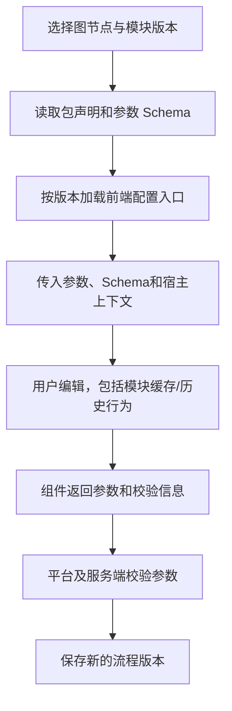

# 前端技术、DAG 画布与动态模块配置

## 指定技术栈

| 用途 | 技术 | 职责 |
| --- | --- | --- |
| 页面框架 | React 19 | 页面与动态配置组件宿主 |
| 开发语言 | TypeScript 7 | 页面、端口、参数和接口类型 |
| 构建 | Vite 8 | 开发与静态资源构建 |
| 基础 UI | HeroUI 3 | 按钮、表单、弹窗 |
| 样式与主题 | Tailwind CSS 4 + CSS Design Tokens | 平台和模块共同主题 |
| 路由 | React Router 7 | 页面、版本、执行和筛选定位 |
| 服务端数据 | TanStack Query 5 | 查询、缓存、刷新和写后同步 |
| 客户端状态 | Zustand 5 | 语言、主题等偏好 |
| 图标 | Lucide React | 导航和状态辅助 |
| 管理接口 | Fetch REST API | 仓库、包、流程、任务、结果查询与操作 |
| 测试 | Playwright E2E + Node.js 测试 | 关键交互和必要纯逻辑 |

以上用户指定主版本已在 web 工作区安装并通过类型检查及生产构建，具体版本固定在 pnpm-lock.yaml。正式基础页已验证双语、主题、路由和真实 API 连接；画布实现与媒体流消息契约另行确定，未增加画布依赖。已落地目录与部署见 [工程结构与部署](15-工程结构与部署.md)。

正式产品以 Web 桌面端为实现与验收范围。按 `AGENTS.md`，中英文文案按业务模块存放在 `src/i18n/<module>.ts`，统一在 `src/i18n/index.ts` 注册，默认 `zh-CN`，偏好保存到 `testflow.locale`。HeroUI 为唯一基础 UI 库，配合 Tailwind 与统一 Tokens；业务类名使用 `.testflow-*`，页面样式放 `web/src/styles/*.css`，支持深浅主题。单文件 HTML 是交互原型，正式前端遵循上述结构。

## 页面和路由建议

2026-10-12 的界面调整以最新用户要求为准：页面顶部仅保留紧凑标题与操作，去掉英文编号和介绍段落；说明性内容保存在文档。下拉框共用 32px 高度、11px 文本和 12px 箭头，弹出选项与边框使用统一 Tokens 和 HeroUI。

所有资源操作统一显示“删除”和垃圾桶图标，不使用遮眼图标。实现保留版本和历史，删除设置 `hidden` 标记；不提供回收站或恢复 API，只能通过数据库恢复。测试集案例、字段、配对和图节点的删除同样使用明确文案。评测卡片和画布的新入口分别见 [评测配置](05-评测配置设计.md#配置卡片与详情2026-10-12) 与 [画布配置入口](04-流程集设计.md#画布配置入口2026-10-12)。

| 页面 | 路由 | 交互 |
| --- | --- | --- |
| admin 登录 | /login | 唯一账号，无个人注册 |
| 仓库 | /repositories | 地址/凭据/分支、同步和版本 |
| 模块 | /modules | ZIP 导入、契约、参数配置组件、Pod 启动和版本 |
| 素材 | /assets | 音频/文字/图片、标签及原始/参考对照 |
| 测试集 | /datasets/:datasetId | 有序输入结构、多字段输入组、素材只读预览 |
| 流程 | /pipelines/:pipelineId | DAG、端口、动态参数及快速运行 |
| 评测配置 | /evaluation-profiles/:profileId | 规则、评测模型、维度和提示词 |
| 任务 | /test-tasks/:taskId | 显式配对、同时执行案例数、模块顺序限制、进度及对比 |
| 执行历史 | /executions | 跨任务、仓库、模块等过滤 |
| 执行详情 | /executions/:executionId | 多模态结果、Trace和评测 |

选中版本、节点/Span 和过滤参数在路由中可恢复。不再提供多轮步骤编辑器或固定内部流程专属页。

## DAG 画布

开始节点固定存在并命名，可新增多个结束节点；普通模块来自 ZIP，组装和显式流式转换为内置能力。普通节点以完整输入组/输出组显示连接点，展开查看字段名称、顺序、类型、格式和流式属性，不提供逐字段跨来源混接。

普通输入组和每个结束节点只接受唯一前置。连线预览校验整组契约，两种方向都不直接跨流式模式；服务端再次检查 DAG、来源、必填数据、版本和格式。同一输出组可以连多个下游，每条逐字段整组匹配；拆分或合并字段经过内置节点，分发复用同一份上游产出。

组装节点有多个来源组入口，右侧配置目标字段、来源节点/字段、命名和顺序，清楚显示未传下游字段。组装不隐藏来源节点的原始 Trace。内容转换由明确能力节点执行。

流程层编辑统一输出规范，全部结束节点引用它，不能各自改为不同结构。点击普通节点加载动态参数组件，同时在流程界面编辑平台提供的节点超时相关设置（Q55）；超时配置与模块业务参数分别保存，固定到流程版本及执行快照。开始编辑输入；结束查看共用规范及状态。保存草稿与可执行版本分开，运行状态展示在固定图版本上。

能力节点抽屉仅编辑名称、描述与 `ModulePanel` 加载的 ZIP 业务参数，移除重复只读输入/输出、Pod 运行信息及节点删除。Pod 默认值在模块详情保存；节点超时和能力版本移到流程设置。画布使用自定义边，在悬停或键盘焦点时显示明确删除控件；点击路径不提交删除。节点删除控件位于节点卡片，固定开始节点受保护。节点描述保存到图、任务快照和 workflow。

要求文字和音频时按完整组展示各字段进度，多个结束节点分别显示状态、唯一来源及最终选用情况；首个完整出口成为最终结果并停止其他分支，全部所需流正常结束才显示完整；首片段和截断分别展示。节点错误停当前案例流程但批次继续，未执行节点与取消收尾明确标记。

## 动态前端组件

用户确认内网运行、ZIP 可信，允许包提供动态配置组件，不限制为仅由平台 Schema 生成表单。参数 Schema 仍保留作数据校验、保存和快照依据。

建议宿主组件接口包括 value、onChange、schema、readonly 和有限上下文；具体接口名需模块 SDK 锁定，不描述为现有能力。

模块组件兼容平台 React/UI 运行环境，主题使用 Tokens。组件返回的参数必须是可保存的数据；节点连线、执行快照和服务端事实仍由平台管理。前端没有会话历史引擎。

历史配置使用固定包版本，只读展示；组件无法加载时显示错误并可展示原始参数，不能丢弃旧配置或换新包重写它。

模块契约详情展示只读配置示例；可保存的参数编辑入口在流程节点。流程未保存状态随参数、运行设置和节点拖动立即更新，并提供恢复上次保存版本的入口。测试集结构编辑复用案例校验与版本保存；嵌套案例编辑取消、关闭或 Escape 返回原向导，字段重绘保留名称。删除的资源没有界面恢复入口，数据库恢复不改写原执行快照。

## 模块运行配置

统一显示 Kubernetes Pod 模式。ZIP 声明镜像、端口、实例复用、顺序要求及可选固定 commit 代码挂载，宿主不提供语言、运行入口或本地/Docker 切换。容器由镜像 ENTRYPOINT/CMD 启动；平台通过 HTTP/WS 契约调用。业务参数由模块 Schema 与配置组件定义，模块内部自行决定是否访问外部接口。

准备超时默认 60 秒，节点运行超时默认 30 秒，独立收尾超时默认 10 秒；均在流程配置并进入快照。WebSocket `/api/v1/live` 使用数据库事件游标恢复展示，连接恢复不提交执行。

## 任务案例并发配置

任务表单提供“同时执行案例数”，默认 1，允许输入 2、3 等正整数。读取所选模块版本的顺序声明；任一模块要求顺序执行时，任务有效值为 1，界面展示所设值、实际生效值及原因，服务端同样校验。

任务详情和报告读取固定快照显示这些设置，不以界面当前草稿替代历史值。该数量表示同时活动的案例流程数，单条案例内的独立 DAG 分支仍可并行。

## 状态归属

| 状态 | 管理 |
| --- | --- |
| 仓库、包、版本、任务、结果、Trace | TanStack Query |
| 资源 ID、选中节点、版本、筛选 | React Router |
| 语言、主题 | Zustand |
| 未提交图、参数、弹窗、组件局部状态 | React 组件及明确的编辑状态 |

任务结果和计数不再复制到偏好存储。音频字节、凭据、全量 Trace 和模块对话缓存不进入 Zustand。

## 接口与实时展示

管理操作使用 Fetch REST。状态和 Trace 可通过有界增量查询更新，实际推送方式未定；模块向后端推送内部 Trace 不等于浏览器已有 WebSocket。

平台后端与适配模块采用 HTTP 管理执行、WebSocket 传递流式输入输出及相关事件；该选择不等于浏览器已经具备相同连接。浏览器媒体合同与模块消息需支持分块、顺序、结束和取消，具体路由、消息和浏览器连接方式在工程契约中确定。状态轮询不能代替音频或 Token 传输。

创建执行、重跑和评分重试是显式写操作，不放在自动刷新的查询中，避免页面重载触发重复执行。运行中展示新进度和旧结果，终态后仅保留必要收尾/评分查询。

任务创建时就固定全部计划项输入，包括尚未启动的排队案例。批次报告使用固定评测配置版本；不同配置或版本的复评保留在执行详情中，工作台按所选口径统计。重跑进行中另外显示活动尝试，已结束结果及其计数仍可查看。

## 详情与主题

音频播放、文字、图片预览按命名字段展示，参考单独显示。Trace 用 DAG 和实际时间线定位，模块未暴露内部过程时说明未暴露。流式首片段、完整输出、结束和取消分别展示。已确定的成功、失败或取消结果保持不变；实际收尾、收尾期限、收尾超时及可控执行终止证据单独展示，远端未确认停止时显示未确认。

HeroUI 与 Tokens 保持平台基础组件一致；动态组件加载失败有可见反馈。执行状态、评分状态、评价类型与判定不只靠颜色区分。

## 验证

类型检查和构建验证指定版本实际组合。Node.js 逻辑验证完整组匹配、组装映射、统一输出、图校验、计划与统计；Playwright 覆盖 ZIP 导入、动态参数、DAG 连线、错误停止、结束输出、报告和统一详情。

真实模块运行验证配置确实生效、batch_id/execution_id/node_id 传递及 Trace 关联，不以配置页面可加载代替后端能力可执行。

当前单文件原型的已验证交互、修正及未实现边界见 [2026-10-11 全流程审查](10-首版范围与验收.md#2026-10-11-原型全流程审查结果)。

## 全局素材与共用列表（2026-10-12）

素材池、测试集、执行详情、报告和历史共用媒体播放器和只读引用预览；素材编辑器只在素材池打开，其他区域通过新标签页定位素材池。编辑/删除采用统一的图标、文字、32px 高度和有边框按钮，确认弹窗独立使用危险操作样式。标签用回车生成可移除标签；图片完整缩略，音频版本变化时恢复播放器媒体地址，切换播放只保留一个活动播放器。

当前案例引用最新素材，历史列表展示冻结素材；点击素材名称或文字内容在新标签页打开当前全局源，不改写执行证据，不显示单独的素材池跳转按钮。字面量案例内容通过输入组编辑修改。测试集每组输入用一个边框分隔，组内沿用素材池的行列表。任务报告、历史与执行详情的输入和最终输出按声明顺序从 1 开始编号，编号旁保留字段名和类型。宽表格在自身区域滚动并固定操作列。评测编辑器的现有、新增维度均默认收缩成一行，展开后保留草稿。模块卡片分开列出输入/输出，平台字段组、类型、画布标签和工作台结果标签均使用业务词典；用户命名、内容和协议标识保持原值。

最新界面删除顶部全局搜索、手动刷新和凭据管理，删除侧栏回收站、连接状态和版本号，以及没有实际多工作区能力的“默认工作区”卡片和面包屑工作区前缀；保留语言、主题、导览与退出。实时订阅继续在内部同步资源。模型 API Key 在模型配置直接填写；Git/镜像等访问凭据在对应表单配置，不依赖全局管理入口。
