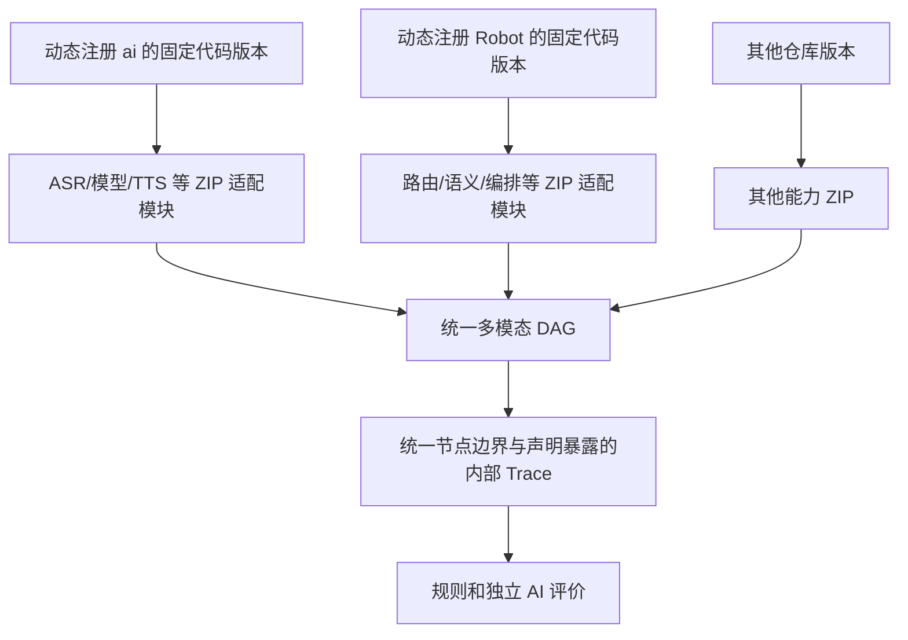

# 现有工程能力抽象与动态模块接入分析

## 当前定位

本文件保留 2026-10-10 对 ai、robot-voice-agent 的静态源码分析事实，按最新动态模块架构整理接入方式。平台位于 `D:\workspace\python\mode_test_platform`，两个原仓库均按需注册，不是 submodule，也不要求平台放入 ai。

本轮只更新文档，没有修改原项目源码、同步远端仓库、加载实际 ZIP 或调用线上接口。静态证据不能解释为模块已经完成或远端运行版本一致。

分析时记录的本地 HEAD：

| 项目 | 证据版本 |
| --- | --- |
| ai | `250c5adbc611eeed96763a4e24e1b93432e034bc` |
| robot-voice-agent | `83d98898eb1133be9150fcafbfc0a562c085c8db` |

实际执行使用仓库管理中固定的 commit，接入时复核对应版本，不使用这两条历史 SHA 作为永久运行默认值。

本文件中的 ai/Robot 源码事实仍是检查时的证据，其专用适配独立于本次交付。平台不限定模块语言：模块内部可以调用既有 HTTP/私有 WebSocket 服务，或引用仓库代码，两者可组合。全部模块由容器镜像在 Kubernetes Pod 启动，平台以 HTTP 管理执行、WebSocket 传流；需要准备的代码按模块依赖声明固定并只读挂载。下文 Python 包及接口约束是这两个项目的实际特点，不是平台对所有模块的限制。

## 接入结论

| 能力 | 已观察事实 | 新平台适配方式 |
| --- | --- | --- |
| ASR | 文件和流式接口已有 | ZIP 声明端口，适配接口或加载对应能力代码 |
| 模型 | 同步代理、受支持流式入口及结构化生成已有 | 模块选择实际入口，声明真实模型和有效参数 |
| TTS | 同步合成、资源读取及实时播报已有 | 模块适配输出资源、音色参数、流式/非流式语义 |
| VAD | ASR 中有内置 Silero 活动检测 | 作为 ASR 内部能力或另行适配独立节点，不能虚构独立接口 |
| AEC、NS | 检查路径中未发现独立服务契约 | 需要已实现代码或独立后端的模块，不因名称存在就可运行 |
| Robot 路由/语义 | 真实编排和受限探测方法已有 | ZIP 加载固定代码并调用或注入，明确模块覆盖 |
| 完整 Robot 入口 | 会话发布、工具、备忘录和会议有业务副作用 | 如封装该能力，逐路径验证拦截，不默认符合原业务边界 |

当前平台只测试模块能力，不要求首版交付完整产品多轮、模式状态机或会议业务验收。模块可以封装较大内部能力，但“模块调用成功”不自动表示产品整体覆盖。

## 仓库职责

ai 提供共享识别、模型和合成能力；robot-voice-agent 拥有 Robot 路由、状态、Product Gate、工具和会议语义。只测共享 AI 能力时可以只注册 ai；需要 Robot 独有代码时再注册 Robot。平台不固定仓库数量或名单。

不是把 Robot 内部代码拆解后重新实现另一套产品规则。模块可封装既有能力，内部层级用主动暴露的 Span 表达。

## 无源码修改的适配

有独立接口或函数时直接调用；有可传入依赖时注入代理；耦合较深时在执行环境局部替换或拦截。仓库同步只提供代码，不能自动解决初始化、依赖、内部全局状态和清理。

Robot 编排构造器已有 realtime、会话发布、路由、模型及工具等依赖注入点，但部分默认仓储和会议捕获在内部创建。禁用 Tools 不能覆盖会话发布、备忘录或会议的全部写入。

拦截业务请求后应保留实际参数和未执行原因，不能返回假的工具成功以继续流程。原代码可能捕获普通异常或在断连清理时推进业务，需要逐路径验证停止与清理。不存在已核实的通用“任意仓库功能一键无副作用模块化”能力。

按模块准备依赖与运行环境，避免两个仓库的同名包、不同依赖和注入互相污染。原代码源文件不变，平台适配代码和运行参数仍需开发与验证。

## ASR 适配事实

- 文件入口包括 `POST /api/v1/asr/file`；voice-service 使用资源引用，gateway 上传代理处理上传再转发，入口请求体不能混用。
- 流式入口包括 voice-service `/api/v3/asr/stream` 及 Qwen 内部 `/api/internal/v3/asr/stream`；ready、final、closed 和取消按所选契约适配。
- 共享文件代理目前支持 qwen-asr，`enableItn` 在相应 Qwen 转发中被忽略，不能在配置界面声称可调且生效。
- `ASR_FILE_USE_V3_STREAM` 是服务环境选择，不是任意每请求参数；文件 PCM 快速发送不等于真实时钟回放。
- 内部 V3 PCM 约束为 16 kHz、单声道、16 bit 小端，帧上限 32 KiB；其它格式须有明确转换及资源来源。
- V3 `saveAudio` 默认关闭，异常收尾可能丢弃捕获，不能据此保证所有真实用户和失败音频已保存。

模块将以上能力映射到自己命名的完整输入/输出组和参数，不能把平台字段名当成原接口已有字段。图内普通节点整组接唯一前置，多来源先经过内置组装；此规则属于平台契约，不要求修改原服务接口。

## 模型适配事实

`llm-service` 的 `POST /internal/v1/chat/completions` 拒绝 `stream=true`，并以服务配置覆盖请求 model。比较模型需不同真实模型入口或实际实例，不能仅改请求名称。

`robot-realtime` 的 `assistant.generate` 使用严格结构化生成，需符合 responseFormat/JSON Schema，不能包装成任意纯文本聊天接口。ASR final、generate、speak 的协议阶段分开，需合法通道状态与 Decision Barrier。

当前代理对部分错误可有三次重试，加首次最多四次后端尝试。平台一次执行调用不意味着后端只试一次，不能虚构内部 Span 或另增计划数。

评测模型独立配置，标准只进入评分侧。远端实际模型和配置身份与本地 commit 分开记录。

## TTS、VAD 与音频前处理

同步 TTS 提供合成及音频读取，返回资源信息，平台需取得可长期保留的媒体。text、参考音、speed 等字段按真实请求契约开放；referenceId 与自定义 reference 互斥。结构化结果必须明确选择可播报文字，不自动朗读全部 JSON。

同步合成与 `assistant.speak` 的参数、流式调度和取消不同，模块分别声明。只有最终文字不能证明音质。

内置 V3 Silero 活动检测观察 PCM 并可发活动事件，不等于独立可调且裁剪音频的 VAD 节点。依赖中出现 AEC 名称、回声文本判断或播放状态控制，也不等于已有音频 AEC 能力。AEC 需对应代码要求的麦克风、播放参考和同步信息。

## Robot 受限能力

`probe_semantic_operation_evidence` 可复用部分真实分类与参数能力；它用隔离 realtime 通道和空 ASR 轮次取得屏障，再处理传入文字，未覆盖完整音频识别、Product Gate、真实业务和多轮路径。调用存在不等于已有任意测试集 HTTP 接口。

控制面 Gold 回放使用仓库已有 caseId/inputText，audioRef 是元数据，不直接执行任意平台录音。部分探测用 expected 选择路径和准备状态，作为模块适配时不能把标准答案泄漏为被测意图提示。

真实 `/api/v1/robot-voice/ws` 有业务写入路径，session.stop 也不能保证异步业务尚未执行。如果需要该模块，仍需满足未撤销的不执行业务边界；不把此限制当作当前平台必须建设产品验收端的理由。

模块内部历史由原代码和模块参数管理。平台传入执行标识，不新增有序会话步骤、重置器或产品状态仓储。

## Trace 与资源

平台包住模块调用记录边界。模块只有声明内部 Trace 暴露后，才主动读取、转换或推送原组件事件，并携带 trace_id/parent_span_id 形成链路。

Robot 控制面 Trace 是有界内存缓冲，`persisted=false`，不天然包含每函数开始/结束及父子 Span。声明暴露的适配器需及时采集并固化，遗漏显示观测不完整；不能自动补全未知节点。

已有服务临时音频及内存事件不能作为永久历史唯一依据。输入、转换及生成媒体保存平台资源引用；缺原始录音不能从文本还原。

## 接入验证

1. 固定仓库 commit、包版本和依赖，验证模块入口加载及真实参数生效。
2. 验证输入输出、完整/流式方式、结束与取消，区分首片段和完整数据。
3. 验证执行 ID 可取得，历史行为按模块配置，不假设自动隔离。
4. 验证内部 Trace 声明、主动上报和上下文关联；未暴露内部过程保持未知。
5. 验证业务拦截、异常和清理路径，不伪造成功。
6. 验证仓库更新不切换活动版本，历史资源长期可播放。

## 本地源码证据

以下为迁移后修正的实际工作区链接；文档描述检查时事实，未在本轮运行源码测试。

| 编号 | 文件 | 证据 |
| --- | --- | --- |
| E01 | [AI 总体架构](D:/workspace/python/ai/docs/机械臂/架构/总体架构.md)、[Robot 三层架构](D:/workspace/python/ai/docs/机械臂/架构/Robot内部三层架构.md) | 原组件职责 |
| E02 | [单 WS 契约](D:/workspace/python/ai/docs/机械臂/协议/Robot-Realtime单WS契约.md)、[realtime core](D:/workspace/python/ai/robot-realtime/robot_realtime/core.py)、[executor](D:/workspace/python/ai/robot-realtime/robot_realtime/qwen_executor.py) | generate/speak、屏障与状态 |
| E03 | [ASR router](D:/workspace/python/ai/voice-service/api/asr_router.py)、[ASR proxy](D:/workspace/python/ai/voice-service/service/asr_proxy_service.py)、[gateway proxy](D:/workspace/python/ai/gateway/service/proxy_service.py) | 文件请求和参数限制 |
| E04 | [V3 公开代理](D:/workspace/python/ai/voice-service/api/asr_v3_router.py) | saveAudio 与收尾 |
| E05 | [V3 内部接口](D:/workspace/python/ai/qwen-asr-vllm-stream-service/api/asr_v3_router.py)、[V3 测试](D:/workspace/python/ai/qwen-asr-vllm-stream-service/tests/test_qwen_asr_v3_stream.py) | PCM 与活动检测 |
| E06 | [LLM API](D:/workspace/python/ai/llm-service/api-service.py) | 模型覆盖、同步入口和重试 |
| E07 | [Robot 编排](D:/workspace/python/robot-voice-agent/service/orchestrator.py)、[WS 入口](D:/workspace/python/robot-voice-agent/api/robot_voice_ws.py) | 真实路由、注入与内部探测 |
| E08 | [TTS router](D:/workspace/python/ai/voice-service/api/tts_sync_router.py)、[TTS service](D:/workspace/python/ai/voice-service/service/tts_sync_service.py)、[schema](D:/workspace/python/ai/voice-service/schema/api_schema.py) | 合成参数和资源 |
| E09 | [启动组合](D:/workspace/python/robot-voice-agent/api-service.py)、[会话发布](D:/workspace/python/robot-voice-agent/repository/conversation_event_repository.py)、[工具编排](D:/workspace/python/robot-voice-agent/service/app_orchestration.py) | 写入与依赖 |
| E10 | [备忘录仓储](D:/workspace/python/robot-voice-agent/repository/memo_draft_repository.py)、[会议捕获](D:/workspace/python/robot-voice-agent/repository/meeting_capture_repository.py)、[会议处理](D:/workspace/python/robot-voice-agent/service/meeting_processing.py) | 其它写入路径 |
| E11 | [控制面 API](D:/workspace/python/robot-voice-agent/api/product_config_control_plane.py)、[控制面服务](D:/workspace/python/robot-voice-agent/service/product_config_control_plane.py)、[回放](D:/workspace/python/robot-voice-agent/service/product_config_replay.py) | Gold 回放和受限能力 |
| E12 | [DecisionTrace](D:/workspace/python/robot-voice-agent/service/decision_trace.py)、[诊断证据](D:/workspace/python/robot-voice-agent/service/diagnostic_evidence.py) | 观察范围和缓冲限制 |

模块规范见 [14](14-ZIP模块与动态配置设计.md)，运行语义见 [09](09-执行与Trace设计.md)。
