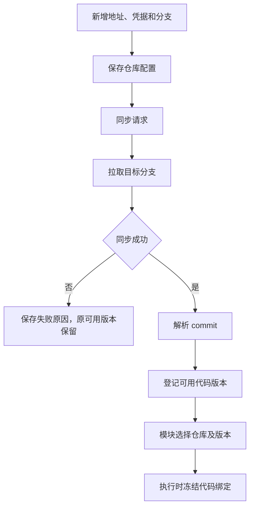

# 动态代码仓库管理设计

## 已确认范围

界面配置仓库地址、账号/密码等访问凭据和分支，代码统一同步到平台管理的目录。不是 Git submodule，也不要求仓库列表写入平台源码或固定为 ai 与 Robot。

凭据按仓库支持方式保存，可使用账号/密码、Token 或 SSH 等引用；这里不新增个人平台账号。引用仓库代码的模块关联仓库标识，由平台解析实际代码位置，避免把本机开发目录硬编码进 ZIP。

## 仓库记录

| 字段 | 含义 |
| --- | --- |
| repository_id、name | 平台内稳定身份与名称 |
| url、branch | 地址和同步目标分支 |
| credential_ref | 后台保存的访问凭据引用 |
| sync_status、error | 待同步、同步中、可用、失败和具体原因 |
| resolved_commit | 最近成功同步得到的实际 commit |
| revision_id、source_root | 可用代码版本及运行时解析位置 |
| synced_at | 本次同步完成时间 |
| hidden | 管理隐藏与阻止新选择 |

字段和状态枚举为设计建议。URL 不包含明文凭据；日志、错误、快照和模块参数不展示密码正文。

## 同步流程



自动同步频率、提交前是否同步等尚未决定，不能默认每次执行都拉取最新分支。同步操作与测试执行是不同动作。

## 统一目录与活动版本

统一目录是仓库管理根，不意味着每个仓库只有一个随时切换的活动分支目录。执行读取固定 commit 对应代码；同步新代码不覆盖正在执行的旧目录。

建议目录形态如下，仅作实现示意，本轮没有创建：

```text
<仓库管理根>/
  <repository_id>/
    git-cache/
    revisions/<commit>/
```

代码版本、依赖环境和正在使用的引用分开管理。全部历史保留规则要求历史需要的版本继续可用，不因仓库隐藏而清除旧代码或关联包。

## 模块绑定

仓库管理为模块准备声明的代码依赖及固定版本，执行快照记录实际 commit。平台不根据模块内部是否调用外部服务判定仓库要求，也不将模块划为仓库型、接口型或组合型。模块及仓库语言不限，镜像通过 ENTRYPOINT/CMD 在 Pod 启动；依赖及代码目录由模块声明，如何调用代码、注入、拦截或调用服务由模块代码自行决定。

多个仓库存在同名包、类、动态库或不兼容依赖时，模块环境需要隔离或明确装载，不将所有仓库依赖放入平台管理进程。具体依赖准备和运行实例复用规则在工程契约中确定。

本地代码 commit 与远端模型服务实际版本分别记录，不能用前者代替后者。

## 运行方式与代码位置

Pod 中的模块需要代码仓库时，平台准备固定 commit 的目录，挂载到配置的容器绝对路径；镜像约定的 ENTRYPOINT/CMD 使用该目录。挂载只提供文件，启动由镜像负责，平台不再要求本地语言或运行入口。已包含代码的镜像可不挂载。源目录属于实际执行/Docker daemon 所在主机，不直接用用户浏览器或个人电脑路径。

平台不选择语言或运行入口，不编译 ZIP 后端代码，也不覆盖镜像启动命令。模块镜像自带代码时不强制绑定仓库；镜像需可启动标准模块服务，挂载代码和模块健康/契约校验分别验证。

## 编辑与删除

修改地址、分支或凭据影响后续同步，不改旧执行快照。新 commit 建立新代码版本，模块/流程明确选择后用于新测试。

删除只是隐藏并阻止新选。已冻结流程及历史仍可读取对应版本，所有既有内容保留。

## 验收与未决项

验证动态注册、同步失败可见、版本固定、活动执行不受更新影响、模块能解析代码位置、凭据脱敏及历史可用。

当前实现手动同步、固定 commit、只读挂载和真实 Pod 可用性校验。运行依赖在模块镜像中准备，代码与产物通过 PVC 保存；版本和被引用仓库源码的边界保持不变。实际挂载及恢复证据见 [实施记录](16-完整实施记录.md)。
