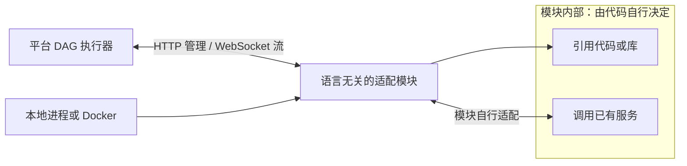
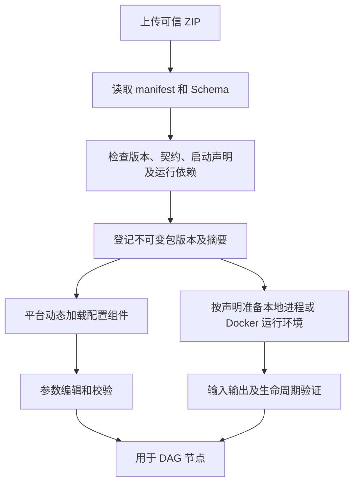

# ZIP 模块、动态配置与运行契约

## 模块定义

模块是一个可导入的能力包，通常由 AI 开发。包描述命名输入、命名输出、参数 Schema、动态前端配置组件及语言无关的运行声明。后端可以使用 Python、Java、Go、Node.js、C++、Rust 或其他能在目标环境运行的语言，不要求平台直接导入某种语言的函数。

平台只对接模块契约与模块的本地进程/Docker 启动。模块内部是否调用外部 HTTP/私有 WebSocket、引用仓库代码或组合使用，由模块代码自行决定；平台不设置能力来源枚举，不要求用户选择“外部接口”“仓库代码”或“仓库 + 外部接口”。需要平台准备的代码依赖按模块运行声明解析并固定版本，平台不修改被引用仓库源码。

用户确认内网使用、ZIP 可信，允许动态加载前端代码。本规范不增加人工审核队列或签名审批流程。导入仍需检查包结构、平台兼容性和参数契约，否则无法正确执行。

模块可以封装 ASR、模型、TTS、图像理解、内部路由等任意满足契约的能力，不以六种语音类型作为硬编码目录。

## 模块边界、启动与通信

| 维度 | 已确认约定 |
| --- | --- |
| 后端运行要求 | 本地进程选择语言/运行配置和入口，支持自定义；Docker 运行环境及启动由镜像负责，不要求选择语言 |
| 平台对接边界 | 模块身份/版本、输入输出、参数、生命周期及运行声明；内部调用方式由代码决定 |
| 启动方式 | 适配模块支持本地进程或 Docker 启动；Docker 是可选运行方式 |
| 平台与模块 | HTTP 管理执行，WebSocket 传递流式输入输出及相关事件 |
| 模块内部实现 | 模块自行处理代码引用、接口调用、协议适配及业务配置，平台不设置来源分类 |

本地进程可以提供 HTTP / WebSocket 服务，HTTP 不要求使用 Docker。平台始终启动和调用同一种模块；本地进程/Docker 是部署方式，不能用来判断模块内部如何实现能力。



图节点来自模块包。平台没有通用外部协议、服务地址或服务版本字段，也不会因为实现使用外部接口就要求选仓库。模块内部接口的初始化、ready、二进制格式、消息解析、增量/累计语义、正常完成、取消和连接复用由代码处理，并映射成统一模块契约。连接关闭不能代替字段正常结束或内部执行停止证据。

统一的是模块执行契约，不是外部服务协议。平台负责准备模块、创建执行、供给完整组或流、接收结果与声明暴露的 Trace、取消执行和记录收尾。HTTP 路由、WebSocket 消息结构、端口发现、就绪检查、启动复用范围和 SDK 的具体字段在实施契约中锁定。stdio、gRPC 未列为本轮必须支持的通信方式。

## 先选择启动方式，再配置对应字段

模块身份、契约及参数不随启动方式改变。导入与流程节点复用同一配置规则，先选本地进程或 Docker，再显示该方式需要的字段：

| 启动方式 | 用户配置 | 启动责任 |
| --- | --- | --- |
| 本地进程 | 下拉选择后端语言/运行配置，按需选择固定代码仓库，再选择运行入口 | 平台按语言运行配置与模块声明准备环境并生成启动调用 |
| Docker | 镜像引用、按需挂载的仓库/版本、容器挂载目录 | 镜像提供运行环境及 ENTRYPOINT/CMD，平台启动镜像并挂载代码，不重复设置语言或运行入口 |

本地语言下拉提供常用运行配置及“其他 / 自定义”，不是平台支持语言的封闭白名单。自定义语言由模块声明启动方式。入口候选来自模块声明或所选仓库固定版本；原型使用预置路径并允许填写其他路径。解释型语言选择脚本，编译型语言选择已构建的可执行文件、JAR 或 DLL；依赖安装、构建和运行版本按模块声明准备，不因选中语言就假定源码已经可运行。

Docker 配置不要求本地语言或本地入口。模块使用可直接启动的镜像，运行环境和模块服务启动命令由镜像的 [ENTRYPOINT/CMD](https://docs.docker.com/reference/dockerfile/#understand-how-cmd-and-entrypoint-interact) 定义。只把仓库目录挂进容器不会自动启动代码；本轮不增加通用基础镜像配任意入口的第二套方式，也不覆盖镜像原启动命令。

挂载仓库时，平台将固定 commit 对应的代码目录作为源，用户选择容器内的绝对目标目录，例如 `/workspace/code`；镜像启动约定需能使用该目录。仓库已包含在镜像中或无仓库依赖时，可以不挂载。真实源目录由执行环境解析，不要求填写个人电脑路径；[bind mount 的源位于 Docker daemon 所在主机](https://docs.docker.com/engine/storage/bind-mounts/)，远程执行环境需要先准备对应代码目录。

切换启动方式保留各自尚未保存的配置，执行快照只保存实际选用的分支。本地保存语言/运行配置、入口、实际生成的启动调用及代码版本；Docker 保存镜像身份、挂载仓库/commit 与容器目录，不将隐藏的本地语言/入口当成 Docker 的运行设置。原型只保存镜像引用，真实执行还需记录解析的镜像身份与就绪证据。

## 包内容建议

```text
module.zip
  manifest.json
  schemas/inputs.json
  schemas/outputs.json
  schemas/config.json
  ui/config-panel.js
  adapter/                 # 任意后端语言的适配源码或产物
  runtime/                 # 启动、构建、依赖或镜像引用声明
  README.md
```

路径和文件名为建议，最终打包格式待 SDK 确定。前端入口应是可供宿主加载的组件产物；原仓库代码由仓库管理引用，不要求复制进每个 ZIP。运行声明可包含本地启动命令、工作目录、依赖锁定信息，或 Docker 镜像及启动要求，不要求包内存在 Python 目录。

## Manifest

| 声明 | 作用 |
| --- | --- |
| 模块 ID、版本、平台契约版本 | 识别与兼容 |
| 按需运行依赖及版本约束 | 准备模块声明的代码、依赖环境或资源，不据此分类模块的业务实现 |
| 本地语言/运行配置、入口及依赖要求 | 准备本地可运行环境，支持自定义语言；Docker 分支不要求这些字段 |
| Docker 镜像及代码挂载声明 | 镜像负责 ENTRYPOINT/CMD；按需选择固定仓库版本及容器挂载目录 |
| 模块就绪要求 | 启动后核验标准模块服务，不以进程/容器创建成功代替可执行 |
| 平台 HTTP / WebSocket 契约版本 | 执行管理、完整数据与流事件的统一接口 |
| 命名有序输入/输出组、类型、格式、流式标记 | 整组连线、运行校验及组装字段映射 |
| 参数 Schema、默认值、前端入口 | 动态配置、验证和保存 |
| Trace 是否暴露、暴露接口 | 控制内部 Trace 采集 |
| 执行边界与覆盖说明 | 区分能力调用、受限探测和业务拦截 |
| 生命周期和状态相关参数 | 准备、完成、取消及模块内部缓存行为 |
| 必须顺序执行的声明 | 平台限制任务案例串行，防止任务并发设置绕过模块要求 |

Manifest 不包含平台能力来源枚举或通用外部接口接入描述。内部服务连接及路由由模块代码处理；需要开放给使用者的业务配置由模块自己的参数 Schema 和组件定义，平台按其契约验证与保存，不预设一套外部服务表单。

Q54 已确认模块可声明必须顺序执行，平台据此把任务有效案例并发限制为 1。具体声明字段及状态作用范围由 SDK 定义，不假定所有模块无状态，也不自动清空历史。

## 导入过程



包成功导入不等于模块已可执行。平台按运行声明检查依赖、启动命令或镜像、模块就绪状态；代码仓库只在被声明为运行依赖时检查，不依据内部是否调用服务推断。内部接口不可用等业务错误由模块通过统一错误契约返回。缺少必需启动条件时显示具体状态，不可用版本不能悄悄执行空实现。

## 前端配置

模块可提供自定义前端配置组件，包括模型参数、提示词以及缓存/历史行为等。宿主传入参数、Schema、只读状态及版本上下文；组件返回可保存参数。

Schema 作为前后端共同数据契约保留，不强制所有界面都由 Schema 自动生成。参数校验最终由后端执行，组件加载成功不代表输出参数合法。

组件版本随 ZIP 固定，使用平台 React/UI 兼容接口和主题 Tokens。具体 SDK 属性名和打包约束是工程契约建议。

## 模块内部代码实现

优先直接调用已存在入口或使用已有依赖注入点；需要时局部代理、替换或拦截。原仓库代码不改，但适配器必须理解初始化、共享状态、异常、清理和实际调用边界。

仓库代码在模块自己的运行环境内加载、编译或启动，不把不同语言或依赖全部塞进平台管理进程。平台启动适配模块并管理其生命周期；模块内部如何引用仓库能力由对应语言的适配代码实现。

外部 HTTP 适配处理请求、响应和错误映射。私有 WebSocket 适配实现目标服务的状态流程，向平台提供统一字段、片段、正常结束、错误及取消结果；不要求平台逐个理解这些业务协议。记录适配器自身事件不表示已取得远端服务全部内部 Trace。

“拦截停止”不能伪造工具成功继续业务，也不能让停止异常被原代码捕获后误当普通错误继续运行。内部能力受限时声明覆盖深度，平台只评价实际得到的输出。

模块可在内部 Trace 主动上报实际调用及模型身份，平台不增加外部服务固定对象或假定已取得全部内部身份。模块自己的配置组件只开放真正生效的参数；接口忽略或覆盖参数时，由模块实现说明实际能力。

本地进程和 Docker 负责适配模块的启动与停止，已有外部服务仍由外部管理。取消单次执行与停止整个共享模块服务分开；本地进程退出、容器停止或连接关闭不证明外部任务已经停止。模块按服务能力请求取消，平台保留实际证据和远端未确认状态。启动复用范围与模块缓存/顺序声明共同进入运行契约。

## 端口与流

输入输出组在 ZIP 中定义有序字段，名称在同一方向唯一，字段含类型、格式和流式属性。普通模块入口接收来自唯一前置的完整输入组，返回符合声明的完整输出组；不能由多个节点分别补齐字段。流式内容按声明交付，不代表开始时已生成完整数据。

一条普通连线整组匹配。字段选择、重命名、排序及多来源组合交给内置组装节点；其来源映射和目标 Schema 固定在流程版本中。同一完整输出组可分发到多个下游，每条链路逐字段匹配；需要不同字段组则通过内置拆分/选择处理，分叉不再次调用上游入口。

两个方向均不能直接跨流式模式，使用内置显式转换能力；音频可流式。模块接口需表达片段、完成、错误和取消。所需流式字段正常结束才算最终结果完整，首片段或截断不满足结束条件。Q52 确认组装在所需静态字段齐备、所需流可读取时启动下游并持续透传，保留流式属性。消息字段及转换协议在实施时细化，流式缓冲策略按 Q56 暂缓。

Q53 确认每节点可设置平台超时，超时为节点错误；Q55 明确超时相关设置在流程界面配置。该配置属于平台执行设置，与模块业务参数分别保存并固定到版本/执行快照；具体计时选项、范围和默认值在实现契约中细化，不将原题固定规则视为已接受。Q56 明确暂缓缓冲满及慢消费者处理。

Q57 确认停止后单独限时收尾；模块声明并提供可配合的结束/取消能力，平台按实际证据记录。到期仍未退出则记录收尾超时并终止平台可控执行，远端未确认停止时如实显示未确认。已确定的成功、失败或取消不改判，实际收尾及已有产物单独保留。具体期限、可控执行终止方式和资源释放在实现契约中细化，不自动恢复模块缓存。

开始节点负责完整素材到输入流的供给。模块不能把同一片段反复累积而不声明这是增量还是累计内容，具体文本流语义待协议统一。

## 执行上下文与内部历史

平台同时将 batch_id、execution_id、node_id 及 Trace 上下文传入入口。同任务共用 batch_id；execution_id 为每条案例每次实际尝试独立产生，重跑新增；node_id 区分图中节点实例。模块按需选择缓存关联键，由代码维护历史，并可通过自定义界面配置行为。

平台不维护模块对话历史，不提供多轮案例推进，不保证跨案例自动重置。三层身份已由 Q46 确认。Q54 确认任务默认同时执行 1 条案例、可调大；模块声明必须顺序执行时平台限制串行。具体 SDK 获取方式、声明字段及状态作用范围在实施时确定。仅保存 ID 和配置不能自动还原模块内存。

## 内部 Trace

包明确声明是否暴露内部 Trace。未声明时平台只记录节点边界；声明后，模块使用平台提供的 trace_id、节点 Span 上下文，主动推送子 Span 和事件。

内部节点携带父 Span 形成链路。事件采集不自动覆盖所有函数、远端调用或缓存；缺失证据按未暴露或观测不完整展示，不补造耗时。

## 版本与验收

新 ZIP、声明依赖绑定、运行声明或参数变更产生新版本。旧执行固定包摘要、实际选用的本地语言/入口/启动调用或 Docker 镜像/代码挂载/容器目录、声明的代码 commit、平台通信契约、模块参数和完整组定义；组装映射、内置转换及所有结束节点的统一规范也随图版本固定，历史全保留。快照没有平台来源分类或通用外部连接字段，模块业务参数仍按自己的 Schema 保存。凭据正文不进入快照；内部服务身份仅保存模块实际上报的证据，不能用本地 commit 或镜像版本代替。

模块交付验证包括：不同后端语言可按声明启动、本地进程与 Docker 使用相同平台契约、无需选择内部实现类型、代码依赖只按声明固定、动态配置确实生效、输入输出符合契约、流式完成/取消可识别、ID 可取得、内部 Trace 仅按声明采集、原代码无需修改、业务边界不被假成功绕过。私有接口适配由模块交付方在代码中实现和验证，不扩展平台的接入分类或固定表单。
