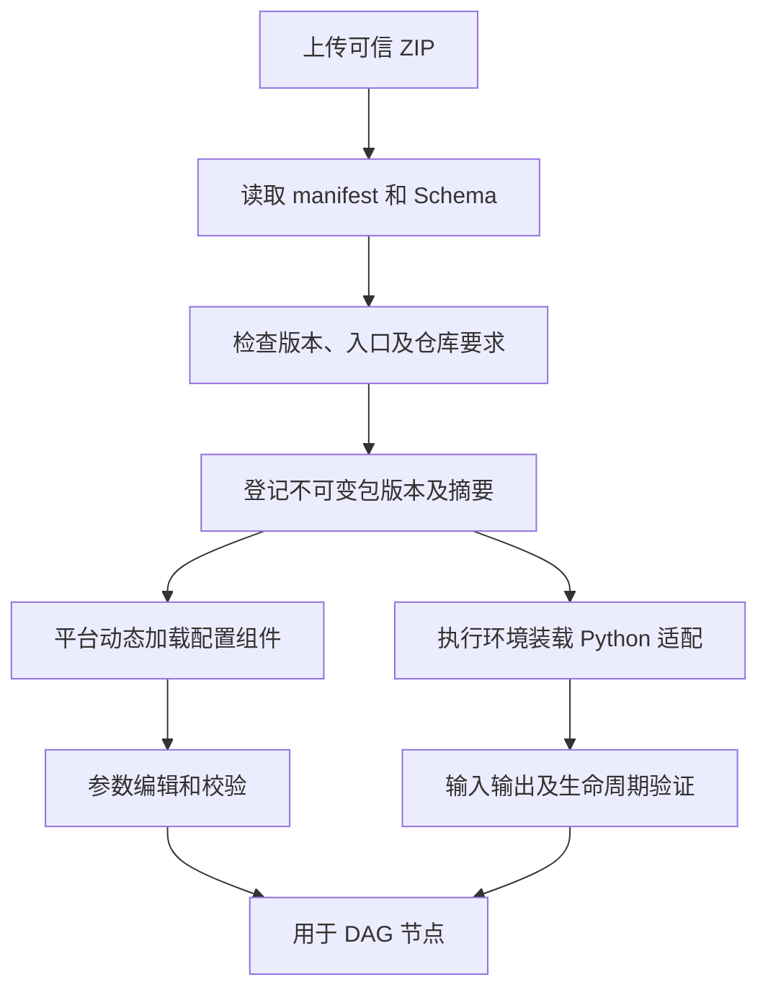

# ZIP 模块、动态配置与运行契约

## 模块定义

模块是一个可导入的能力包，通常由 AI 开发。包描述命名输入、命名输出、参数 Schema、动态前端配置组件和 Python 执行入口，适配已注册仓库中的真实代码。

用户确认内网使用、ZIP 可信，允许动态加载前端代码。本规范不增加人工审核队列或签名审批流程。导入仍需检查包结构、平台兼容性和参数契约，否则无法正确执行。

模块可以封装 ASR、模型、TTS、图像理解、内部路由等任意满足契约的能力，不以六种语音类型作为硬编码目录。

## 包内容建议

```text
module.zip
  manifest.json
  schemas/inputs.json
  schemas/outputs.json
  schemas/config.json
  ui/config-panel.js
  python/entry.py
  requirements.lock 或运行环境引用
  README.md
```

路径和文件名为建议，最终打包格式待 SDK 确定。前端入口应是可供宿主加载的组件产物；原仓库代码由仓库管理引用，不要求复制进每个 ZIP。

## Manifest

| 声明 | 作用 |
| --- | --- |
| 模块 ID、版本、平台契约版本 | 识别与兼容 |
| 仓库要求及代码版本约束 | 解析真实源代码 |
| Python 入口和运行要求 | 调用及依赖准备 |
| 命名有序输入/输出组、类型、格式、流式标记 | 整组连线、运行校验及组装字段映射 |
| 参数 Schema、默认值、前端入口 | 动态配置、验证和保存 |
| Trace 是否暴露、暴露接口 | 控制内部 Trace 采集 |
| 执行边界与覆盖说明 | 区分能力调用、受限探测和业务拦截 |
| 生命周期和状态相关参数 | 准备、完成、取消及模块内部缓存行为 |
| 必须顺序执行的声明 | 平台限制任务案例串行，防止任务并发设置绕过模块要求 |

Q54 已确认模块可声明必须顺序执行，平台据此把任务有效案例并发限制为 1。具体声明字段及状态作用范围由 SDK 定义，不假定所有模块无状态，也不自动清空历史。

## 导入过程



包成功导入不等于所有来源能力已可执行。缺仓库、依赖或适配验证时显示具体状态；不可用版本不能悄悄执行空实现。

## 前端配置

模块可提供自定义前端配置组件，包括模型参数、提示词以及缓存/历史行为等。宿主传入参数、Schema、只读状态及版本上下文；组件返回可保存参数。

Schema 作为前后端共同数据契约保留，不强制所有界面都由 Schema 自动生成。参数校验最终由后端执行，组件加载成功不代表输出参数合法。

组件版本随 ZIP 固定，使用平台 React/UI 兼容接口和主题 Tokens。具体 SDK 属性名和打包约束是工程契约建议。

## Python 适配

优先直接调用已存在入口或使用已有依赖注入点；需要时局部代理、替换或拦截。原仓库代码不改，但适配器必须理解初始化、共享状态、异常、清理和实际调用边界。

“拦截停止”不能伪造工具成功继续业务，也不能让停止异常被原代码捕获后误当普通错误继续运行。内部能力受限时声明覆盖深度，平台只评价实际得到的输出。

调用外部服务时记录实际能力和模型身份。接口可能忽略某参数或覆盖模型名，配置界面只开放真正生效的能力，固定服务值只读。

## 端口与流

输入输出组在 ZIP 中定义有序字段，名称在同一方向唯一，字段含类型、格式和流式属性。普通模块入口接收来自唯一前置的完整输入组，返回符合声明的完整输出组；不能由多个节点分别补齐字段。流式内容按声明交付，不代表开始时已生成完整数据。

一条普通连线整组匹配。字段选择、重命名、排序及多来源组合交给内置组装节点；其来源映射和目标 Schema 固定在流程版本中。同一完整输出组可分发到多个下游，每条链路逐字段匹配；需要不同字段组则通过内置拆分/选择处理，分叉不再次调用上游入口。

两个方向均不能直接跨流式模式，使用内置显式转换能力；音频可流式。模块接口需表达片段、完成、错误和取消。所需流式字段正常结束才算最终结果完整，首片段或截断不满足结束条件。Q52 确认组装在所需静态字段齐备、所需流可读取时启动下游并持续透传，保留流式属性。消息字段及转换协议在实施时细化，流式缓冲策略按 Q56 暂缓。

Q53 确认每节点可设置平台超时，超时为节点错误；Q55 明确超时相关设置在流程界面配置。该配置属于平台执行设置，与模块业务参数分别保存并固定到版本/执行快照；具体计时选项、范围和默认值在实现契约中细化，不将原题固定规则视为已接受。Q56 明确暂缓缓冲满及慢消费者处理。

Q57 确认停止后单独限时收尾；模块声明并提供可配合的结束/取消能力，平台按实际证据记录。到期仍未退出则记录收尾超时并终止平台可控执行，远端未确认停止时如实显示未确认。已确定的成功、失败或取消不改判，实际收尾及已有产物单独保留。具体期限、可控执行终止方式和资源释放在实现契约中细化，不自动恢复模块缓存。

开始节点负责完整素材到输入流的供给。模块不能把同一片段反复累积而不声明这是增量还是累计内容，具体文本流语义待协议统一。

## 执行上下文与内部历史

平台同时将 batch_id、execution_id、node_id 及 Trace 上下文传入入口。同任务共用 batch_id；execution_id 为每条案例每次实际尝试独立产生，重跑新增；node_id 区分图中节点实例。模块按需选择缓存关联键，由代码维护历史，并可通过自定义界面配置行为。

平台不维护模块对话历史，不提供多轮案例推进，不保证跨案例自动重置。三层身份已由 Q46 确认。Q54 确认任务默认同时执行 1 条案例、可调大；模块声明必须顺序执行时平台限制串行。具体 SDK 获取方式、声明字段及状态作用范围在实施时确定。仅保存 ID 和配置不能自动还原模块内存。

## 内部 Trace

包明确声明是否暴露内部 Trace。未声明时平台只记录节点边界；声明后，模块使用平台提供的 trace_id、节点 Span 上下文，主动推送子 Span 和事件。

内部节点携带父 Span 形成链路。事件采集不自动覆盖所有函数、远端调用或缓存；缺失证据按未暴露或观测不完整展示，不补造耗时。

## 版本与验收

新 ZIP、代码绑定或参数变更产生新版本。旧执行固定包摘要、代码 commit、参数和完整组定义；组装映射、内置转换及所有结束节点的统一规范也随图版本固定，历史全保留。

模块交付验证包括：动态配置确实生效、输入输出符合契约、流式完成/取消可识别、ID 可取得、内部 Trace 仅按声明采集、原代码无需修改、业务边界不被假成功绕过。
