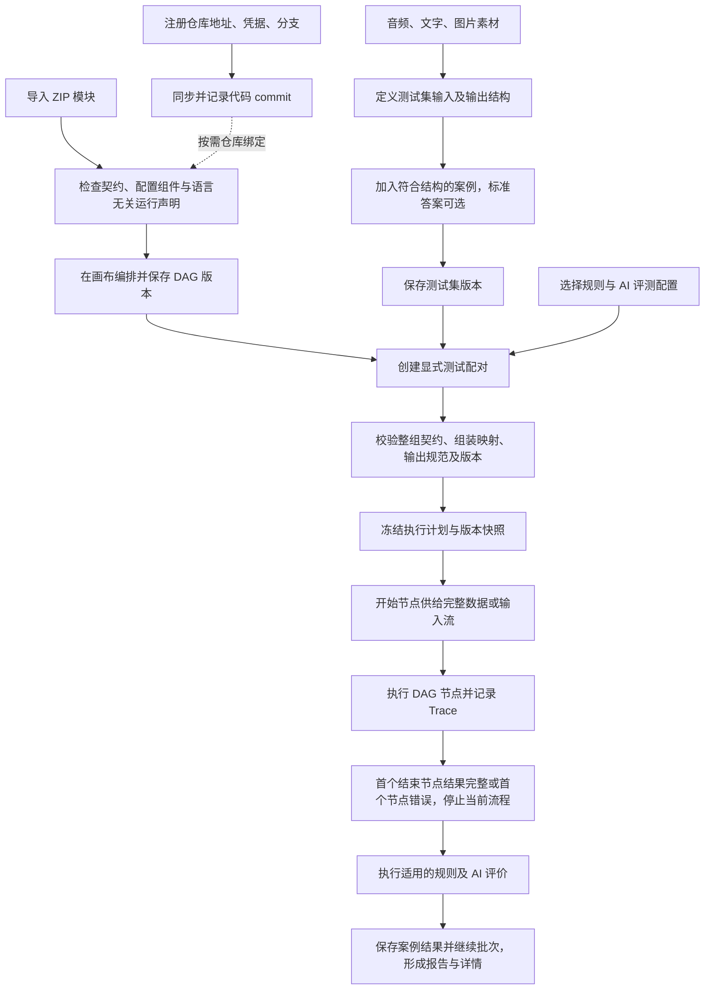

# 模块能力测试平台设计文档

更新时间：2026-10-12。项目根目录：TestFlow 仓库根目录。

2026-10-12 新增 [GitHub 仓库代码、ZIP 与 workflow 闭环](19-GitHub仓库与workflow闭环.md)：示例适配层从固定 commit 挂载导入业务函数，workflow 支持依赖预览、可迁移导出和跨安装重绑定。新增下载文件的 GitHub 发布状态与实际集群验收分别记录。

2026-10-12 增加 [素材包、测试集和正常工作区示例](20-示例素材和测试集导入闭环.md)：可移植素材 ZIP、固定素材依赖的测试集 JSON、配套素材导出，以及完整示例的重复安装脚本。

2026-10-12 按最新反馈调整 [界面密度、评测卡片与画布交互](21-界面密度和画布交互调整.md)：统一紧凑下拉与删除按钮，移除页头介绍，节点库按需展开，节点参数使用右侧抽屉，流程设置独立弹窗。本次增量验收为 28 项真实交互与 36 个布局组合；受调整区域不再沿用旧截图的像素验收结论。

平台面向内部人员，通过按需注册代码仓库、导入语言无关的 ZIP 适配模块和编排多模态 DAG，测试模块及其组合的输入输出能力。平台只对接模块契约和 Kubernetes Pod 启动，以 HTTP 管理模块执行、以 WebSocket 传递流式数据；模块内部是否调用外部接口、引用仓库代码或组合使用，由模块代码自行决定。平台不修改被引用仓库的源代码；具体调用、依赖注入和拦截由模块适配代码实现。

本目录沿用迁移前的 `voice-test-platform` 路径和文件编号，内容以本页及 QA 当前决策为准。旧的线性模板、平台多轮会话、固定内部流程专属执行器、缺标准一律不评分和本地/Docker 模式均已被替代。设计要求与实际验收分别记录，当前证据以 [完整实施记录](16-完整实施记录.md) 为准。

正式前后端已完成仓库、模块、素材、测试集、流程、评测、任务和执行八个业务域的真实能力，部署为 Python + FastAPI 单体、前端和 PostgreSQL 18。真实三语言 Pod、Kimi 评测、浏览器闭环、九页严格视觉和 108 个布局组合均已通过；实际麦克风按用户要求保持未验收。目录与启动见 [工程结构与部署](15-工程结构与部署.md) 与 [根 README](../../README.md)。

2026-10-12 增加 [全局素材与多模态列表完善](22-全局素材和多模态列表完善.md)：素材引用、统一编辑、标签、媒体预览、维度折叠及最新内容与历史快照分层。

## 全流程界面原型

打开 [demo.html](../demo.html) 可查看单文件交互原型，无需安装依赖。点击右上角“体验全流程”依次查看仓库、模块、素材、测试集、DAG 画布、评测配置、测试任务和执行历史。

原型支持创建和编辑、整组契约校验、节点拖动及连线、案例并发与模块顺序限制、故障后继续批次、任务取消、独立重跑与复评，以及 Trace、版本快照和历史报告查看。可导入本地音频、图片、文字，并使用浏览器录音；录音停止后自动入池。音频在浏览器内转换为 WAV / 16kHz / 单声道。

原型模块页统一为 Kubernetes Pod 模式，在能力模块中保存镜像、服务端口、资源、复用范围及按需仓库挂载默认值，没有本地语言、运行入口或启动方式切换。平台没有能力来源分类或通用外部服务连接表单。流程节点侧栏编辑名称、描述和能力业务参数；流程设置调整节点超时及固定能力修订。创建节点继承模块运行默认值，任务快照固定模块版本、运行设置和业务参数，详见 [配置归属](24-能力运行配置与节点业务参数.md)。

HTML 原型的仓库同步、ZIP 契约、模块和 AI 评分均为明确标注的模拟，不连接真实服务或启动 Pod。预置音频为提示音，示例文字与提示音不对应；精确转写维度使用演示转写与独立参考计算 CER，AI 分数为 0–1。演示数据仅保存在当前页面内存，刷新恢复初始数据。正式前后端使用真实持久化和执行，默认安装不导入这些模拟记录。

原型和正式界面的 [验证入口](../../tests/README.md) 覆盖资源接入、测试集修订、DAG、任务、取消、重跑、复评、报告及快照。历史原型审查见 [全流程审查结果](10-首版范围与验收.md#2026-10-11-原型全流程审查结果)，最新实现与限制见 [实施记录](16-完整实施记录.md)。此 HTML 用于审阅界面与交互；正式前端使用下文指定技术栈。

## 当前有效设计

| 部分 | 已确认内容 |
| --- | --- |
| 仓库 | 配置地址、访问凭据和分支，统一同步到平台管理目录，不使用 Git submodule |
| 模块 | 导入可信 ZIP，包含命名输入输出、参数 Schema、动态前端配置组件及语言无关适配/运行声明 |
| 实现边界 | 模块内部代码自行决定调用方式，平台不设置能力来源枚举或外部连接固定字段 |
| 启动与通信 | 全部容器模块统一 Pod，镜像 ENTRYPOINT/CMD；可选固定 commit 只读挂载，HTTP 管理 + WebSocket 流式 |
| 流程 | 命名开始节点、可新建多个结束节点，自由 DAG；所有结束节点共用统一输出规范 |
| 连接 | 同一完整输出可分发多链路，各下游逐字段整组匹配；拆分/选择/合并字段用内置节点，每个普通输入及结束节点唯一前置 |
| 输入 | 测试集定义有序、命名的数据结构，案例必须提供全部要求的数据 |
| 匹配 | 测试集与开始节点严格匹配字段名称、类型、顺序和格式约束 |
| 流式 | 静态字段齐备、所需流可读取时组装并启动下游，持续透传；跨模式用显式转换，最终所需流正常结束才完整 |
| 结束 | 任一结束节点先取得符合统一规范的完整组即成功并停止其他分支；所需流均正常结束才算完整 |
| 错误 | 在流程界面配置节点超时相关设置，超时作为错误停止当前案例；批次继续其他案例，终态不改判 |
| 收尾 | 停止后单独限时；到期记录收尾超时并终止平台可控执行，实际收尾状态与已确定终态分别展示 |
| 状态 | 同时传 batch_id、execution_id、node_id；模块自行决定缓存和配置，平台不维护多轮历史 |
| 观察 | 平台统一记录节点输入、输出、耗时、状态；模块声明暴露内部 Trace 后，透传 Trace/Span 上下文并推送内部事件 |
| 评测 | 精确内容由规则判断，开放表达由独立 AI 评分；标准可选，无参考答案质量评价有明确维度、证据和无法判定状态 |
| 任务 | 显式集合→流程配对；同时执行案例数默认 1、可调整；模块要求顺序时任务限制串行，统一评测配置 |
| 历史 | 新执行、新评分追加记录，固定代码及配置版本，保留所有旧内容；删除只隐藏，历史音频仍能播放 |
| 使用者 | 内网、可信模块、唯一 admin 登录；无个人账号、人员记录或人工评分裁决 |

没有标准答案不等于没有评价目标。缺少参考转写不能计算 CER；可根据原始材料和明确规则进行的质量评价单独展示，不混入参考答案正确性统计。

原先不执行真实动作或被测业务写入、不建设模拟业务验收端的边界尚未被撤销。模块必须声明能力覆盖与执行边界；“代码可信”不表示已经验证全部拦截点。测试平台保存素材、配置和结果照常进行。

## 整体流程

## 文档导航

| 文档 | 内容 |
| --- | --- |
| [QA](QA.md) | 最新决策、用户原话、旧决策替代关系和待讨论边界 |
| [01 平台整体设计](01-平台整体设计.md) | 平台目标、页面、系统职责及完整业务流程 |
| [02 素材池设计](02-语音池设计.md) | 音频、文字、图片素材；保留旧文件名 |
| [03 测试集设计](03-测试集设计.md) | 有序输入结构、案例、可选标准、输出结构和严格匹配 |
| [04 流程集设计](04-流程集设计.md) | DAG、完整组绑定、内置组装、多个结束节点与快速测试 |
| [05 评测配置设计](05-评测配置设计.md) | 规则、参考答案评价、无参考答案质量评价和复评 |
| [06 测试任务设计](06-测试任务设计.md) | 显式配对、执行计划、快照、进度、统计和重试 |
| [07 执行历史与详情](07-执行历史与详情设计.md) | 全局筛选、多模态结果、节点与内部 Span 详情 |
| [08 数据关系与版本](08-数据关系与版本设计.md) | 仓库、模块、Schema、任务、执行和历史关联 |
| [09 执行与 Trace](09-执行与Trace设计.md) | 流式执行、终止收敛、取消、ID 和 Trace 契约 |
| [10 首版范围与验收](10-首版范围与验收.md) | 新范围、验收场景和未决边界 |
| [11 前端技术与页面架构](11-前端技术与页面架构.md) | 指定技术栈、画布与动态模块组件 |
| [12 现有工程接入分析](12-现有工程能力抽象与接入分析.md) | ai、Robot 的既有源码事实及模块适配边界 |
| [13 代码仓库管理](13-代码仓库管理设计.md) | 动态注册、同步、版本固定及凭据管理 |
| [14 ZIP 模块规范](14-ZIP模块与动态配置设计.md) | 模块包、前端配置、语言无关适配、启动与通信契约 |
| [15 工程结构与部署](15-工程结构与部署.md) | 工程结构、单体边界、Kubernetes 和验证范围 |
| [16 完整实施记录](16-完整实施记录.md) | 实际联调、视觉、恢复、交付和暂缓验收 |
| [17 原型控件对应表](17-原型控件对应表.md) | 90 项具名交互及历史、增量验收归属 |
| [18 极小模型场景与界面对照](18-极小模型场景与界面对照.md) | 真实微型模型场景与详情视觉差异记录 |
| [19 GitHub 仓库与 workflow 闭环](19-GitHub仓库与workflow闭环.md) | 固定代码挂载、模块包与可移植流程 |
| [20 示例素材和测试集导入闭环](20-示例素材和测试集导入闭环.md) | 可移植测试数据与本地示例部署 |
| [21 界面密度和画布交互调整](21-界面密度和画布交互调整.md) | 最新五项界面要求及实际 Kubernetes 验收 |
| [22 全局素材和多模态列表完善](22-全局素材和多模态列表完善.md) | 共用编辑、素材引用、媒体列表、标签和折叠维度 |

## 前端技术栈

React 19、TypeScript 7、Vite 8、HeroUI 3、Tailwind CSS 4 + CSS Design Tokens、React Router 7、TanStack Query 5、Zustand 5、Lucide React、Fetch REST API、Playwright E2E + Node.js 测试。

模块前端组件已经通过宿主桥接动态加载共享 React、HeroUI 和 SDK，参数 Schema 用于校验、保存和快照。画布采用 @xyflow/react 12.12.0；指定依赖已通过类型与生产构建，模块 HTTP/WS 和媒体片段契约见 [模块开发契约](../../contracts/module/README.md)。

## 本轮决策与后续细化

- Q66–Q67：完整前后端实施、全部模块容器化、Pod 启动、真实跨语言示例和 Minikube 验收。已完成当前授权范围，实际麦克风按最新用户要求暂缓。
- Q65：后端保持单体，按业务域组织，不拆独立 Worker。

- Q63 的本地/Docker 选择已被 Q66 的 Pod-only 决策替代；镜像负责 ENTRYPOINT/CMD，平台配置镜像及可选代码挂载。
- Q58–Q62：不限制模块后端语言；平台只对接模块和Pod 启动，使用 HTTP 管理执行、WebSocket 传流。模块内部调用方式由代码决定，不设置“外部接口/仓库/组合”来源分类；运行依赖按模块声明准备。具体消息、运行声明及就绪/复用细节在实施契约中锁定。

- Q55：超时相关设置在流程界面配置；具体计时选项、范围和默认值留在工程契约，未限定为原题建议的固定模式。
- Q56：流式供给过快、缓冲满和慢消费者处理暂缓，不作为当前待回答问题或本轮验收承诺。
- Q57：停止后单独限时收尾；到期记录收尾超时并终止平台可控执行，远端实际停止据证据展示。已确定成功、失败或取消结果不变，收尾单独记录。

Q54 已确认任务提供“同时执行案例数”，默认 1，可调大；任一所选流程模块声明必须顺序执行时，任务有效并发为 1。图内独立分支仍可并行。

Q52 已确认组装就绪后逐片传流，Q53 已确认每节点平台超时并按错误处理。具体分块、媒体传输、超时配置选项、收尾期限值及终止方式在实现时细化；不将暂缓的缓冲策略视为已确认。

Q49–Q51 已确认首完整出口结束、同一产出整组分发及所需流正常结束；Q46–Q48 的身份分层、失败案例继续批次和内置双向流式转换同样有效。组装未选字段不传下游，原节点实际产出仍保留 Trace/历史。

以上已集中到 QA。本轮没有新增待回答问题；尚未限定的工程细节和暂缓建议不视为已确认实现。

- [输入组、素材只读预览与工作区简化](23-输入组与简化工作区.md)
- [能力运行配置与节点业务参数](24-能力运行配置与节点业务参数.md)
