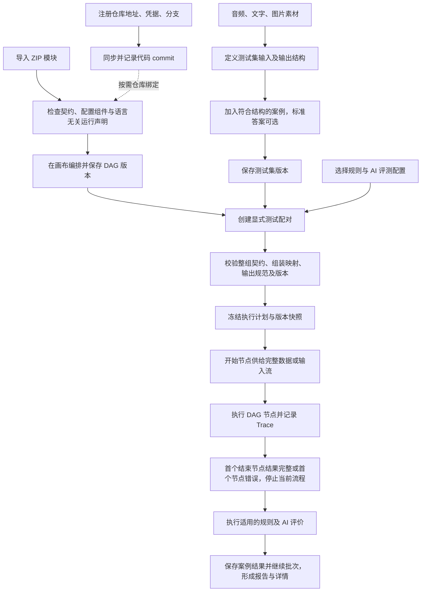

# 模块能力测试平台设计文档

更新时间：2026-10-11。项目根目录：TestFlow 仓库根目录。

平台面向内部人员，通过按需注册代码仓库、导入语言无关的 ZIP 适配模块和编排多模态 DAG，测试模块及其组合的输入输出能力。平台只对接模块契约和本地进程/Docker 启动，以 HTTP 管理模块执行、以 WebSocket 传递流式数据；模块内部是否调用外部接口、引用仓库代码或组合使用，由模块代码自行决定。平台不修改被引用仓库的源代码；具体调用、依赖注入和拦截由模块适配代码实现。

本目录沿用迁移前的 `voice-test-platform` 路径和文件编号，内容以本页及 QA 当前决策为准。旧的线性模板、平台多轮会话、固定内部流程专属执行器和缺标准一律不评分方案已被替代。文档描述目标设计，不代表平台已经实现或完成联调。

前后端基础工程现已初始化：指定前端技术栈、Python + FastAPI 单体后端、Kubernetes 部署模板。系统状态与健康接口可用，八个业务域仍待实现。实际目录、启动和验收范围见 [工程结构与部署](15-工程结构与部署.md) 与 [根 README](../../README.md)。

## 全流程界面原型

打开 [demo.html](../demo.html) 可查看单文件交互原型，无需安装依赖。点击右上角“体验全流程”依次查看仓库、模块、素材、测试集、DAG 画布、评测配置、测试任务和执行历史。

原型支持创建和编辑、整组契约校验、节点拖动及连线、案例并发与模块顺序限制、故障后继续批次、任务取消、独立重跑与复评，以及 Trace、版本快照和历史报告查看。可导入本地音频、图片、文字，并使用浏览器录音；录音停止后自动入池。音频在浏览器内转换为 WAV / 16kHz / 单声道。

原型模块页先选择本地进程/Docker：本地下拉选语言（含自定义）及入口，Docker 配镜像和按需仓库挂载，不要求本地语言或入口。平台没有能力来源分类或通用外部服务连接表单。流程节点可编辑模块运行设置，校验启动条件并将模块版本、运行设置和业务参数保存在执行快照。

仓库同步、ZIP 契约载入、被测模块和 AI 评分均为明确标注的模拟，不连接真实服务、不执行 ZIP 代码或启动本地进程/Docker。预置音频为提示音，示例文字与提示音不对应；精确转写维度使用实际演示转写与独立参考计算 CER。演示数据仅保存在当前页面内存，刷新恢复初始数据。

原型已补充 [运行逻辑与浏览器端到端验证](../../tests/README.md)，覆盖资源接入、测试集修订、DAG、任务、取消、重跑、复评、报告及快照。详细检查、修正与未实现部分见 [全流程审查结果](10-首版范围与验收.md#2026-10-11-原型全流程审查结果)。此 HTML 用于审阅界面与交互；正式前端仍使用下文指定技术栈。演示中的超时计时方式、收尾期限和容量限制不是新增产品决策。

## 当前有效设计

| 部分 | 已确认内容 |
| --- | --- |
| 仓库 | 配置地址、访问凭据和分支，统一同步到平台管理目录，不使用 Git submodule |
| 模块 | 导入可信 ZIP，包含命名输入输出、参数 Schema、动态前端配置组件及语言无关适配/运行声明 |
| 实现边界 | 模块内部代码自行决定调用方式，平台不设置能力来源枚举或外部连接固定字段 |
| 启动与通信 | 先选本地/Docker；本地选语言与入口，Docker 使用镜像启动命令并按需挂载代码；统一 HTTP 管理 + WebSocket 流式 |
| 流程 | 命名开始节点、可新建多个结束节点，自由 DAG；所有结束节点共用统一输出规范 |
| 连接 | 同一完整输出可分发多链路，各下游逐字段整组匹配；拆分/选择/合并字段用内置节点，每个普通输入及结束节点唯一前置 |
| 输入 | 测试集定义有序、命名的数据结构，案例必须提供全部要求的数据 |
| 匹配 | 测试集与开始节点严格匹配字段名称、类型、顺序和格式约束 |
| 流式 | 静态字段齐备、所需流可读取时组装并启动下游，持续透传；跨模式用显式转换，最终所需流正常结束才完整 |
| 结束 | 任一结束节点先取得符合统一规范的完整组即成功并停止其他分支；所需流均正常结束才算完整 |
| 错误 | 在流程界面配置节点超时相关设置，超时作为错误停止当前案例；批次继续其他案例，终态不改判 |
| 收尾 | 停止后单独限时；到期记录收尾超时并终止平台可控执行，实际收尾状态与已确定终态分别展示 |
| 状态 | 同时传 batch_id、execution_id、node_id；模块自行决定缓存和配置，平台不维护多轮历史 |
| 观察 | 平台统一记录节点输入、输出、耗时、状态；模块声明暴露内部 Trace 后，透传 Trace/Span 上下文并推送内部事件 |
| 评测 | 精确内容由规则判断，开放表达由独立 AI 评分；标准可选，无参考答案质量评价有明确维度、证据和无法判定状态 |
| 任务 | 显式集合→流程配对；同时执行案例数默认 1、可调整；模块要求顺序时任务限制串行，统一评测配置 |
| 历史 | 新执行、新评分追加记录，固定代码及配置版本，保留所有旧内容；删除只隐藏，历史音频仍能播放 |
| 使用者 | 内网、可信模块、唯一 admin 登录；无个人账号、人员记录或人工评分裁决 |

没有标准答案不等于没有评价目标。缺少参考转写不能计算 CER；可根据原始材料和明确规则进行的质量评价单独展示，不混入参考答案正确性统计。

原先不执行真实动作或被测业务写入、不建设模拟业务验收端的边界尚未被撤销。模块必须声明能力覆盖与执行边界；“代码可信”不表示已经验证全部拦截点。测试平台保存素材、配置和结果照常进行。

## 整体流程

## 文档导航

| 文档 | 内容 |
| --- | --- |
| [QA](QA.md) | 最新决策、用户原话、旧决策替代关系和待讨论边界 |
| [01 平台整体设计](01-平台整体设计.md) | 平台目标、页面、系统职责及完整业务流程 |
| [02 素材池设计](02-语音池设计.md) | 音频、文字、图片素材；保留旧文件名 |
| [03 测试集设计](03-测试集设计.md) | 有序输入结构、案例、可选标准、输出结构和严格匹配 |
| [04 流程集设计](04-流程集设计.md) | DAG、完整组绑定、内置组装、多个结束节点与快速测试 |
| [05 评测配置设计](05-评测配置设计.md) | 规则、参考答案评价、无参考答案质量评价和复评 |
| [06 测试任务设计](06-测试任务设计.md) | 显式配对、执行计划、快照、进度、统计和重试 |
| [07 执行历史与详情](07-执行历史与详情设计.md) | 全局筛选、多模态结果、节点与内部 Span 详情 |
| [08 数据关系与版本](08-数据关系与版本设计.md) | 仓库、模块、Schema、任务、执行和历史关联 |
| [09 执行与 Trace](09-执行与Trace设计.md) | 流式执行、终止收敛、取消、ID 和 Trace 契约 |
| [10 首版范围与验收](10-首版范围与验收.md) | 新范围、验收场景和未决边界 |
| [11 前端技术与页面架构](11-前端技术与页面架构.md) | 指定技术栈、画布与动态模块组件 |
| [12 现有工程接入分析](12-现有工程能力抽象与接入分析.md) | ai、Robot 的既有源码事实及模块适配边界 |
| [13 代码仓库管理](13-代码仓库管理设计.md) | 动态注册、同步、版本固定及凭据管理 |
| [14 ZIP 模块规范](14-ZIP模块与动态配置设计.md) | 模块包、前端配置、语言无关适配、启动与通信契约 |
| [15 工程结构与部署](15-工程结构与部署.md) | 已落地基础工程、单体边界、Kubernetes 和验证范围 |

## 前端技术栈

React 19、TypeScript 7、Vite 8、HeroUI 3、Tailwind CSS 4 + CSS Design Tokens、React Router 7、TanStack Query 5、Zustand 5、Lucide React、Fetch REST API、Playwright E2E + Node.js 测试。

模块前端组件计划动态加载，参数 Schema 仍用于校验、保存和快照。指定前端依赖已通过基础工程类型与构建验证；具体画布实现与媒体流消息契约继续在实施时确定，不擅自替换已指定主版本。

## 本轮决策与后续细化

- Q65：初始化前后端基础工程，Kubernetes 部署，后端暂定单体。目录按业务域组织，当前不拆独立 Worker；真实模块执行与业务功能随后实施。

- Q63：先选启动方式。本地进程下拉选择语言和入口，支持自定义运行配置；Docker 使用镜像 ENTRYPOINT/CMD，仅配置镜像及按需代码仓库/容器目录，不重复设置本地入口。
- Q58–Q62：不限制模块后端语言；平台只对接模块和本地/Docker 启动，使用 HTTP 管理执行、WebSocket 传流。模块内部调用方式由代码决定，不设置“外部接口/仓库/组合”来源分类；运行依赖按模块声明准备。具体消息、运行声明及就绪/复用细节在实施契约中锁定。

- Q55：超时相关设置在流程界面配置；具体计时选项、范围和默认值留在工程契约，未限定为原题建议的固定模式。
- Q56：流式供给过快、缓冲满和慢消费者处理暂缓，不作为当前待回答问题或本轮验收承诺。
- Q57：停止后单独限时收尾；到期记录收尾超时并终止平台可控执行，远端实际停止据证据展示。已确定成功、失败或取消结果不变，收尾单独记录。

Q54 已确认任务提供“同时执行案例数”，默认 1，可调大；任一所选流程模块声明必须顺序执行时，任务有效并发为 1。图内独立分支仍可并行。

Q52 已确认组装就绪后逐片传流，Q53 已确认每节点平台超时并按错误处理。具体分块、媒体传输、超时配置选项、收尾期限值及终止方式在实现时细化；不将暂缓的缓冲策略视为已确认。

Q49–Q51 已确认首完整出口结束、同一产出整组分发及所需流正常结束；Q46–Q48 的身份分层、失败案例继续批次和内置双向流式转换同样有效。组装未选字段不传下游，原节点实际产出仍保留 Trace/历史。

以上已集中到 QA。本轮没有新增待回答问题；尚未限定的工程细节和暂缓建议不视为已确认实现。
